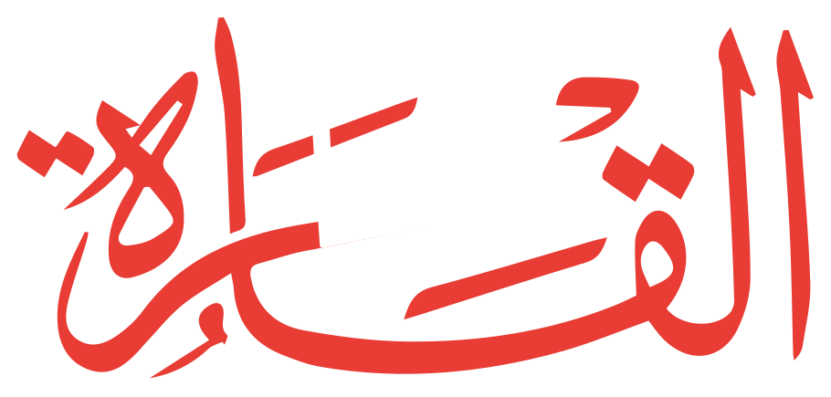
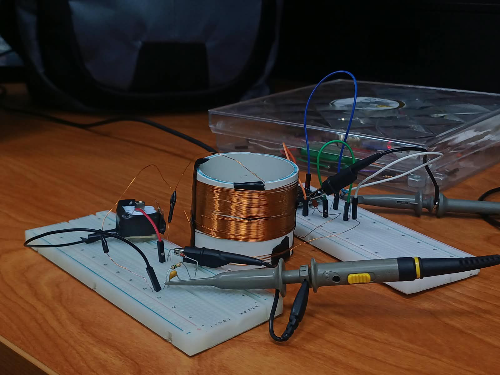

# Complete website code

Every authored source file is included below in its own labelled code block. Copy each block to the named relative path. The accompanying ZIP includes the existing photographs, videos, and LAB2.pdf; binary files cannot be pasted as source code.

## skills/atmospheric-vanilla-web/SKILL.md

````markdown
---
name: atmospheric-vanilla-web
description: Design original atmospheric editorial websites with plain HTML, CSS and JavaScript, bold typography, real project imagery and purposeful interaction. Use for Noureldin's radio site or requests for this saved visual direction.
---

# Atmospheric vanilla web

Create a distinctive experience whose interaction explains its subject. Read [reference observations](references/direction.md). These are design principles, not a template to reproduce.

## Composition

- Begin with one project-specific visual: actual photography, an artifact, or an original diagram. Give it space to establish identity before detailed content.
- Pair an expressive headline with small technical labels and generous spacing. Preserve Arabic shaping and reading direction. Avoid equally prominent competing headlines.
- Use one accent against restrained neutrals. A cinematic opening can lead into a quieter reading area; preserve light/dark preferences. Text over imagery needs a contrast layer.
- Alternate immersive moments with calm explanation. Avoid placing every paragraph in a rounded card or adding decorative filler.
- Let the subject suggest the motif: copper, dial marks and signal flow for the radio. Never import another brand's symbols, assets, copy or distinctive composition.

## Interaction

Choose one primary interaction per section. For the radio: selecting a signal stage changes an explanatory waveform; selecting a component focuses its model and explains its role. Distinguish illustrative signals and nominal geometry from measured evidence.

Use native buttons, ranges and details with touch and keyboard equivalents. Prefer brief transitions, modest pointer depth and scroll entry cues. Avoid scroll hijacking, mandatory preloaders, cursor replacement, autoplay audio, endless particle loops and effects that obscure content. Reduced motion must retain all information with instant state changes.

Preserve the no-framework, no-build-step constraint unless the user changes it. Keep copy in the established content file. Pause ongoing animation offscreen and when hidden. Do not add libraries for decoration.

## Review

Inspect desktop and narrow-screen renders. Check first-screen identity and action, long-copy readability, crops, focus visibility, touch sizing and overflow. Exercise interactions and return paths; inspect browser errors. Fix observed problems and recheck affected areas. Never claim perfection or award-level quality based on code alone.

Keep measurements, credits, future milestones and navigation intact. Redesign authorization does not authorize unrelated services or publication destinations. Follow the current task's publication instructions.
````

## skills/atmospheric-vanilla-web/references/direction.md

````markdown
# Reference observations

Reviewed November 5–6, 2026. External designs may change.

## Vevilos — https://v4vevilos.gr/

Visually observed: photographic backdrop, dark contrast layers, large artist lettering, concentrated warm accent, small identity labels and pronounced hierarchy. The page also contains a timeline, visual log and optional lyric interaction. Transfer the connection between subject, atmosphere and interaction—not its red neon styling or composition.

## Awwwards vanilla JavaScript collection

https://www.awwwards.com/websites/vanilla-js/

Inspected listing entries including Vevilos, Soo, Hozon, DOT Audio Recorder and Money in Check. Listing is a discovery signal, not evidence every entry won an award or uses dependency-free JavaScript. The radio's stricter no-library constraint remains.

## DOT Audio Recorder listing

https://www.awwwards.com/sites/dot-audio-recorder

Inspected the Awwwards description and highlight labels: product-video hero, short explanatory blocks and waveform leading to a closing action. Its live destination was not inspected: browser approval failed on a usage limit. Do not report unseen animation, performance or accessibility as verified.

## Team 14 interpretation

Actual bench photography as atmosphere; Arabic project title as dominant identity; copper signal lines; an interactive route from airwaves to sound; focused component inspection; calm lab notes. Generated geometry remains approximate. This is an educational guide, not a concert page or a game.
````

## css/experience.css

````css
/* Editorial exhibit layer. Accent colour remains controlled by style.css variables. */
body { padding-left: 0; }
.wrap { max-width: 1440px; }
.site-header { min-height: 88px; border-bottom: 1px solid var(--line); }
.hero { position: relative; gap: 4vw; padding: 32px 0 48px; align-items: center; }
.hero-copy { display: flex; flex-direction: column; align-items: flex-start; }
.hero-copy > .eyebrow { order: -2; margin-bottom: 28px; }
.hero h1 { font-size: clamp(40px,4.2vw,64px); line-height: 1.3; margin: 12px 0 4px; }
.editorial-title { font: 500 clamp(52px,6vw,92px)/.91 Arial,sans-serif; letter-spacing: -.075em; margin: 0; }
.editorial-title span { display: block; }
.editorial-title span:last-child { color: var(--accent-ink); font-family: Georgia,serif; font-style: italic; letter-spacing: -.06em; }
.hero .tagline { font-size: clamp(18px,1.7vw,26px); margin: 8px 0; }
.hero-intro { max-width: 53ch; font-size: .82rem; line-height: 1.7; margin: 10px 0 14px; }
.primary-link { font-size: .8rem; margin: 0; }
.workbench-jump { background: var(--ink); color: var(--paper); padding: 15px 22px; border: 0; margin: 16px 0 0; border-radius: 100px; transition: transform .2s; }
.workbench-jump:hover { transform: translateY(-3px); }
.team-line { margin-top: 28px; padding-top: 16px; width: 100%; }
.opening-exhibit { --dial-angle: 0deg; background: var(--soft); border-radius: 260px 260px 8px 8px; padding: 36px 32px 24px; min-width: 0; position: relative; }
.exhibit-top { display: flex; justify-content: space-between; font: 9px monospace; letter-spacing: .13em; padding-top: 32px; }
.exhibit-art { position: relative; aspect-ratio: 1.15; display: grid; place-items: center; }
.exhibit-art img { position: relative; width: 83%; height: 100%; object-fit: contain; transform: rotate(calc(-10deg + var(--dial-angle)*.15)); transition: transform .35s ease-out; filter: drop-shadow(0 20px 18px #0002); }
.orbit { position: absolute; width: 88%; aspect-ratio: 1; border: 1px solid var(--line); border-radius: 50%; }
.orbit-two { width: 72%; border-style: dashed; transform: rotate(var(--dial-angle)); transition: transform .3s; }
.orbit-one::after { content: ''; position: absolute; top: 12%; left: 14%; width: 9px; height: 9px; border-radius: 50%; background: var(--accent-ink); }
.orbit-label { position: absolute; bottom: 0; font: 10px monospace; letter-spacing: .04em; }
.exhibit-bottom { text-align: center; padding-top: 20px; }
.exhibit-bottom h2 { font: italic 28px Georgia,serif; margin: 0; }
.exhibit-bottom p { font-size: 10px; color: var(--muted); margin: 7px 0 25px; }
.opening-dial { display: flex; justify-content: space-between; gap: 10px; font-size: 10px; }
.opening-dial output { color: var(--accent-ink); font-family: monospace; white-space: nowrap; }
#opening-frequency { width: 100%; accent-color: var(--accent-ink); margin: 14px 0 8px; cursor: ew-resize; }
.frequency-ruler { display: flex; justify-content: space-between; padding-top: 18px; background: repeating-linear-gradient(90deg,var(--line) 0 1px,transparent 1px 10px) top/100% 10px no-repeat; font: 9px monospace; color: var(--muted); }
.overview { padding: 50px 0; }
.overview-head h2 { font-size: clamp(30px,4vw,56px); letter-spacing: -.045em; }
.signal-chain li { background: transparent; border: 0; border-top: 1px solid var(--line); border-radius: 0; padding-inline: 0; }
.chapter-heading h2 { font-size: clamp(36px,5vw,70px); letter-spacing: -.05em; }
.chapter-section { padding-block: 60px; }
.section-label h3 { letter-spacing: -.03em; }
.problem-card,.theory-grid > div { background: transparent; border-width: 1px 0 0; border-radius: 0; padding-inline: 0; }
.problem-grid,.theory-grid { gap: 32px; }
.bench-layout { border-radius: 10px; overflow: hidden; }
.bench-stage { background: #292e32; }
.part-inspector { background: var(--soft); }
.part-portrait { height: 150px; }
.part-portrait img { max-height: 140px; }
.focus-option { display: flex; align-items: center; gap: 8px; font-size: 12px; margin-top: 20px; }
.focus-option input { accent-color: var(--accent-ink); }
.parts-tray button { border-radius: 0; border-width: 0 0 1px; background: transparent; }
.parts-tray button[aria-pressed="true"] { background: var(--soft); border-color: var(--accent-ink); }
.bench-toolbar button { border-radius: 100px; }
@media(min-width:960px){.hero { grid-template-columns: 1.05fr 1fr; }.opening-exhibit { max-width: 550px; width:100%; justify-self: end; }.bench-layout { grid-template-columns: minmax(0,1fr) 250px; }}
@media(min-width:1200px){
  .section-sidebar { width: 166px; padding: 110px 8px 25px; transform: translateX(-100%); transition: transform .3s; background: var(--paper); }
  .reading-build .section-sidebar { transform: translateX(0); }
  .milestones { margin-left: 155px; }
  .section-sidebar a { font-size: .67rem; }
}
@media(max-width:959px){.hero { gap: 40px; }.editorial-title { font-size: clamp(56px,10vw,90px); }.opening-exhibit { max-width: 520px; width:100%; justify-self:center; }}
@media(max-width:619px){.hero { padding-top:30px; }.hero-copy>.eyebrow{margin-bottom:20px}.hero h1{font-size:48px}.opening-exhibit{padding:25px 20px 20px}.exhibit-top{padding-top:20px}.editorial-title{font-size:clamp(54px,16vw,90px)}.team-line ul{flex-wrap:wrap}.chapter-section{padding-block:40px}.bench-toolbar{gap:4px}.bench-toolbar button{padding:8px;font-size:10px}.exhibit-bottom h2{font-size:25px}}
@media print{.opening-exhibit,.editorial-title,.focus-option{display:none}.milestones{margin-left:0}.hero{display:block}.section-sidebar{display:none!important}}

/* Atmospheric radio direction: real photography and a quiet interactive signal study. */
.broadcast-hero { isolation:isolate; display:block; min-height:660px; margin:24px 0 0; padding:64px 48px 94px; background:#292e32; color:#f4f7f9; overflow:hidden; border-radius:3px; }
.broadcast-photo { position:absolute; inset:0; z-index:-2; }
.broadcast-photo img { width:100%; height:100%; object-fit:cover; object-position:72% 50%; opacity:.65; transform:scale(1.04) translate(var(--photo-x,0px),var(--photo-y,0px)); transition:transform .6s ease-out; }
.broadcast-photo::after { content:''; position:absolute; inset:0; background:linear-gradient(90deg,#292e32f5 0%,#292e32d9 35%,#292e3225 100%),linear-gradient(0deg,#292e32 0%,transparent 50%); }
.broadcast-photo figcaption { position:absolute; right:24px; bottom:80px; font:10px monospace; color:#b8c8d2; max-width:28ch; text-align:right; }
.broadcast-hero .hero-copy { position:relative; z-index:1; max-width:660px; }
.broadcast-hero .eyebrow { color:#b8c8d2; margin-bottom:18px; }
.broadcast-hero h1 { font:700 clamp(62px,8.2vw,118px)/1.5 'Segoe UI',Arial,sans-serif; margin:0; letter-spacing:-.04em; text-shadow:0 5px 40px #0006; }
.broadcast-hero .tagline { font:italic clamp(24px,3vw,42px)/1.22 Georgia,serif; max-width:20ch; margin:0 0 20px; }
.broadcast-hero .hero-intro { color:#e5ebef; max-width:46ch; font-size:14px; line-height:1.8; }
.hero-actions { display:flex; align-items:center; flex-wrap:wrap; gap:20px; margin-top:16px; }
.broadcast-hero .workbench-jump { background:#f4f7f9; color:#292e32; margin:0; padding:15px 22px; min-height:48px; }
.broadcast-hero .primary-link { background:transparent; border-bottom:1px solid #607d8b; color:#f4f7f9; padding:12px 0; }
.broadcast-hero .team-line { color:#e5ebef; border-color:#ffffff30; margin-top:30px; font-size:11px; }
.broadcast-hero .team-label { color:#b8c8d2; }
.broadcast-band { position:absolute; bottom:0; left:0; right:0; display:flex; justify-content:space-between; align-items:center; flex-wrap:wrap; gap:12px; padding:22px 28px; border-top:1px solid #ffffff20; font:10px monospace; letter-spacing:.08em; background:#292e32c9; z-index:2; }
.broadcast-band a { color:#ff827b; text-decoration:none; padding:5px; }
.hero-wave { position:absolute; right:-8%; bottom:90px; width:60%; height:160px; z-index:-1; opacity:.45; pointer-events:none; }
.hero-wave path { fill:none; stroke:color-mix(in srgb,var(--accent),white 45%); stroke-width:1.4; }
.signal-story { padding:100px 0 70px; scroll-margin-top:30px; }
.signal-story-head { display:grid; grid-template-columns:1.2fr 1fr; gap:15px 80px; align-items:end; margin-bottom:35px; }
.signal-story-head .eyebrow { grid-column:1/-1; margin:0; }
.signal-story-head h2 { font-size:clamp(36px,4.5vw,66px); max-width:12ch; }
.signal-story-head>p:last-child { max-width:45ch; color:var(--muted); font-size:14px; margin:0; }
.signal-explorer { display:grid; grid-template-columns:235px 1fr; border-block:1px solid var(--line); }
.signal-stages { display:flex; flex-direction:column; border-right:1px solid var(--line); padding:18px 20px 18px 0; }
.signal-stages button { position:relative; display:grid; grid-template-columns:26px 1fr; gap:1px 10px; text-align:left; padding:14px; border:0; background:transparent; min-height:70px; }
.signal-stages button>span { grid-row:span 2; font:10px monospace; color:var(--muted); padding-top:6px; }
.signal-stages small { font-size:10px; }
.signal-stages button[aria-pressed=true] { background:var(--soft); color:var(--accent-ink); }
.signal-stages button[aria-pressed=true]::after { content:'↗'; position:absolute; right:12px; top:16px; }
.signal-screen { padding:25px 32px; min-width:0; background:radial-gradient(ellipse at 80% 10%,var(--soft),transparent 70%); }
.signal-screen-label { display:flex; justify-content:space-between; font:10px monospace; color:var(--muted); letter-spacing:.08em; }
.signal-screen svg { width:100%; height:180px; margin:10px 0; }
.signal-baseline { stroke:var(--line); fill:none; }
#signal-path { stroke:var(--accent-ink); stroke-width:2; fill:none; }
.signal-description h3 { font:400 28px/1.2 Georgia,serif; margin-bottom:12px; }
.signal-description p { font-size:14px; color:var(--muted); max-width:65ch; min-height:4.9em; }
.signal-screen-footer { display:flex; gap:16px; align-items:center; justify-content:space-between; border-top:1px solid var(--line); padding-top:14px; }
.signal-screen-footer>span { font-size:10px; color:var(--muted); }
.signal-screen-footer button { border:0; background:transparent; color:var(--accent-ink); font-size:12px; padding:12px 0 12px 12px; min-height:44px; white-space:nowrap; }
@media(max-width:959px){.broadcast-hero{padding:40px 30px 110px;min-height:640px}.broadcast-hero h1{font-size:82px}.signal-story-head{gap:20px 40px}.signal-explorer{grid-template-columns:190px 1fr}.signal-screen{padding:25px}.signal-description p{min-height:6.5em}}
@media(max-width:619px){.broadcast-hero{padding:30px 22px 120px;min-height:690px}.broadcast-hero h1{font-size:clamp(48px,13.6vw,78px)}.broadcast-hero .hero-intro{font-size:12px}.broadcast-hero .tagline{font-size:28px}.broadcast-photo img{object-position:60% center;opacity:.4}.broadcast-photo::after{background:linear-gradient(90deg,#292e32ee,#292e3270)}.broadcast-photo figcaption{display:none}.broadcast-hero .team-line{margin-top:25px}.broadcast-band{padding:18px;font-size:9px}.broadcast-band>span:nth-child(2){display:none}.hero-actions{gap:12px}.hero-wave{width:100%;bottom:70px}.signal-story{padding:60px 0 35px}.signal-story-head{display:block}.signal-story-head h2{margin:15px 0 20px;max-width:15ch}.signal-explorer{display:block}.signal-stages{flex-direction:row;overflow-x:auto;border-right:0;border-bottom:1px solid var(--line);padding:10px 0;gap:5px}.signal-stages button{flex:0 0 145px;font-size:13px;min-height:75px}.signal-screen{padding:22px 10px}.signal-screen svg{height:130px}.signal-description h3{font-size:25px}.signal-description p{min-height:8em}.signal-screen-label{font-size:8px}}
@media(prefers-reduced-motion:reduce){.broadcast-photo img{transform:none!important}}
@media print{.broadcast-hero{min-height:0;padding:20px;color:#111;background:white}.broadcast-photo,.hero-wave,.broadcast-band,.hero-actions{display:none}.broadcast-hero .hero-intro,.broadcast-hero .eyebrow,.broadcast-hero .team-line{color:#333}.signal-story{padding:20px 0}.signal-stages{display:none}.signal-explorer{display:block}.signal-screen-footer button{display:none}}

.broadcast-hero h1{width:min(100%,540px);margin:12px 0 24px;line-height:1;} .project-logo{width:100%;height:auto;max-height:270px;object-fit:contain;}
:root{--accent-ink:#bd2923;} :root[data-theme="dark"]{--accent-ink:#ff827b;} @media(prefers-color-scheme:dark){:root:not([data-theme="light"]){--accent-ink:#ff827b;}}

.broadcast-hero h1{width:min(100%,620px);margin:28px 0 32px;} .project-logo{max-height:none;aspect-ratio:910/435;object-fit:contain;} .header-logo{width:120px;height:auto;} :root[data-theme="light"] .wordmark{background:#292e32;border-radius:5px;padding:5px 10px;} @media(prefers-color-scheme:light){:root:not([data-theme="dark"]) .wordmark{background:#292e32;border-radius:5px;padding:5px 10px;}} @media(max-width:619px){.header-logo{width:92px}.broadcast-hero h1{margin:24px 0;}}

/* Hero composition: description left, project identity right, shared team footer. */
.broadcast-hero .hero-copy{display:grid;grid-template-columns:minmax(0,1fr) minmax(0,1.25fr);max-width:none;width:100%;column-gap:5%;align-items:center;}
.broadcast-hero .hero-copy>.eyebrow{grid-column:1/-1;grid-row:1;margin-bottom:48px;}
.broadcast-hero h1{grid-column:2;grid-row:2/4;width:100%;margin:0;align-self:center;}
.broadcast-hero .hero-intro{grid-column:1;grid-row:2;margin:0;align-self:end;max-width:48ch;font-size:15px;}
.broadcast-hero .hero-actions{grid-column:1;grid-row:3;align-self:start;margin-top:24px;}
.broadcast-hero .hero-wave{position:relative;grid-column:1/-1;grid-row:4;left:auto;right:auto;bottom:auto;width:min(100%,820px);height:100px;margin:36px auto 8px;z-index:0;}
.broadcast-hero .team-line{grid-column:1/-1;grid-row:5;display:flex;justify-content:center;align-items:center;flex-wrap:wrap;margin:0;padding-top:12px;text-align:center;}
.broadcast-hero .team-line ul{justify-content:center;}
.broadcast-photo figcaption{display:none;}
@media(max-width:700px){.broadcast-hero .hero-copy{grid-template-columns:1fr}.broadcast-hero .hero-copy>.eyebrow{margin-bottom:24px}.broadcast-hero h1{grid-column:1;grid-row:2;width:85%;justify-self:end;margin-bottom:28px}.broadcast-hero .hero-intro{grid-row:3;font-size:14px}.broadcast-hero .hero-actions{grid-row:4}.broadcast-hero .hero-wave{grid-row:5;height:70px;margin-top:24px}.broadcast-hero .team-line{grid-row:6;gap:12px}.broadcast-hero{min-height:0;padding-bottom:110px}}
````

## js/experience.js

````javascript
/* Original radio exhibit; all copy and signal-stage definitions live in content.js. */
(() => {
  const p=window.RADIO_CONTENT.project,c=p.exhibit,s=window.RADIO_CONTENT.signalStory;
  if(!c||!s)return;
  const esc=v=>String(v).replace(/[&<>"']/g,x=>({'&':'&amp;','<':'&lt;','>':'&gt;','"':'&quot;',"'":'&#39;'})[x]);
  const guide=document.createElement('a');guide.href=p.capacitorGuide.src;guide.textContent=p.capacitorGuide.label;document.querySelector('#m1-gallery').parentElement.after(guide);
  const reduced=matchMedia('(prefers-reduced-motion: reduce)');
  const hero=document.querySelector('.hero');hero.classList.add('broadcast-hero');
  const photo=hero.querySelector('.hero-photo');photo.className='broadcast-photo';photo.querySelector('.photo-label')?.remove();
  const copy=hero.querySelector('.hero-copy');copy.querySelector('.tagline').remove();copy.querySelector('h1').innerHTML='';
  const actions=document.createElement('div');actions.className='hero-actions';
  const follow=copy.querySelector('.primary-link'),jump=copy.querySelector('.workbench-jump');jump.textContent=c.action+' ↗';
  actions.append(jump,follow);copy.querySelector('.team-line').before(actions);
  const band=document.createElement('div');band.className='broadcast-band';
  band.innerHTML=`<span>${esc(c.kicker)}</span><span>${esc(c.detail)}</span><a href="#signal-story">${esc(c.signalLink)} ↓</a>`;hero.append(band);
  const wave=document.createElementNS('http://www.w3.org/2000/svg','svg');wave.classList.add('hero-wave');wave.setAttribute('viewBox','0 0 1200 160');wave.setAttribute('aria-hidden','true');
  const line=document.createElementNS(wave.namespaceURI,'path');
  line.setAttribute('d',Array.from({length:601},(_,i)=>`${i?'L':'M'}${i*2},${80+Math.sin(i*.23)*(12+50*Math.exp(-Math.pow((i-400)/110,2)))}`).join(' '));wave.append(line);copy.querySelector('.team-line').before(wave);
  const story=document.createElement('section');story.id='signal-story';story.className='signal-story';story.setAttribute('aria-labelledby','signal-story-title');
  story.innerHTML=`<div class="signal-story-head"><p class="eyebrow">${esc(s.eyebrow)}</p><h2 id="signal-story-title">${esc(s.title)}</h2><p>${esc(s.intro)}</p></div><div class="signal-explorer"><div class="signal-stages" role="group" aria-label="${esc(s.controls)}">${s.stages.map((v,i)=>`<button type="button" data-signal="${i}" aria-pressed="${i===0}"><span>0${i+1}</span>${esc(v.name)}<small>${esc(v.status)}</small></button>`).join('')}</div><div class="signal-screen"><div class="signal-screen-label"><span>${esc(s.screenLabel)}</span><span id="signal-stage-number"></span></div><svg viewBox="0 0 800 180" role="img" aria-labelledby="signal-svg-title"><title id="signal-svg-title"></title><path class="signal-baseline" d="M0 90H800"/><path id="signal-path"/></svg><div class="signal-description" aria-live="polite" aria-atomic="true"><h3 id="signal-name"></h3><p id="signal-copy"></p></div><div class="signal-screen-footer"><span>${esc(s.note)}</span><button type="button" id="signal-next">${esc(s.next)} →</button></div></div></div>`;
  document.querySelector('.overview').before(story);
  let stage=0;
  function show(i){stage=i;const item=s.stages[i];story.querySelectorAll('[data-signal]').forEach((b,n)=>b.setAttribute('aria-pressed',String(n===i)));
    document.querySelector('#signal-name').textContent=item.title;document.querySelector('#signal-copy').textContent=item.text;
    document.querySelector('#signal-svg-title').textContent=item.waveAlt;document.querySelector('#signal-stage-number').textContent=`0${i+1} / ${s.stages.length}`;
    const path=Array.from({length:801},(_,x)=>{const envelope=24+15*Math.sin(x*.018);let y;
      if(item.wave==='air')y=16*Math.sin(x*.21)+15*Math.sin(x*.37)+13*Math.sin(x*.09);
      else if(item.wave==='tuned')y=envelope*Math.sin(x*.24);
      else if(item.wave==='gain')y=envelope*1.6*Math.sin(x*.24);
      else if(item.wave==='detected')y=envelope;
      else y=48*Math.sin(x*.018);
      return `${x?'L':'M'}${x},${90-y}`;}).join(' ');
    document.querySelector('#signal-path').setAttribute('d',path);
    if(!reduced.matches&&story.animate)story.querySelector('.signal-description').animate([{opacity:.3,transform:'translateY(6px)'},{opacity:1,transform:'none'}],{duration:220});
  }
  story.querySelectorAll('[data-signal]').forEach((b,i)=>b.addEventListener('click',()=>show(i)));
  document.querySelector('#signal-next').addEventListener('click',()=>show((stage+1)%s.stages.length));show(0);
  let scheduled=false;
  const update=()=>{scheduled=false;document.body.classList.toggle('reading-build',document.querySelector('#milestones').getBoundingClientRect().top<140);};
  document.addEventListener('scroll',()=>{if(!scheduled){scheduled=true;requestAnimationFrame(update);}},{passive:true});update();
  hero.addEventListener('pointermove',e=>{if(reduced.matches||e.pointerType!=='mouse')return;const r=hero.getBoundingClientRect();hero.style.setProperty('--photo-x',`${(e.clientX-r.left-r.width/2)*.012}px`);hero.style.setProperty('--photo-y',`${(e.clientY-r.top-r.height/2)*.012}px`);});
  hero.addEventListener('pointerleave',()=>{hero.style.setProperty('--photo-x','0px');hero.style.setProperty('--photo-y','0px');});
})();
````

## MODEL-CAPTURE-GUIDE.md

````markdown
# Help us make the model match your circuit

The current model is a nominal, procedural reconstruction. Generated component illustrations cannot establish unseen geometry or exact breadboard connections.

## Best first upload

1. A sharp overhead photo of the whole circuit with a ruler beside it.
2. Front, back, left, right and top photos of the coil and tuning capacitor. Include the underside if accessible without damaging the build.
3. Close-ups of the detector and ESP32, with printed markings and breadboard row numbers readable.
4. Dimensions in millimetres: pipe outside diameter and height, winding width and position, board length/width, capacitor body and shaft, and distances between parts.
5. An annotated overhead photo identifying TP1, TP3, ground, component terminals and where each jumper goes. Hidden wires need a written connection list.

Use diffuse light, a plain background, no portrait blur, and original-resolution files. Keep the circuit unchanged between views. Take overlapping views around each object at several heights; include detail shots of small parts. A slow video helps us understand placement, but sharp stills are more useful for dimensions and markings. Do not dismantle a working circuit just to capture a hidden surface.

If available, include manufacturer part numbers/datasheets, CAD files, or an exported phone scan (GLB, OBJ or STL). A scan may still need cleanup, particularly around thin wires, shiny metal and transparent plastic.

Start with the coil and tuner. We can correct those first, then boards, detector parts and wiring. Label files by component and angle, for example `coil-front.jpg`, and put dimensions in `dimensions.txt`.
````

## index.html

````html
<!doctype html>
<html lang="en">
<head>
  <meta charset="utf-8">
  <meta name="viewport" content="width=device-width, initial-scale=1">
  <meta name="color-scheme" content="light dark">
  <title>هنا القاهرة — Team 14's AM Radio Build</title>
  <meta name="description" content="Three students, one AM radio. Follow Team 14's tuner and detector build, experiments, fixes, and measurements for ELEG103 at SBME, Fall 2026.">
  <meta property="og:type" content="website">
  <meta property="og:locale" content="en_US">
  <meta property="og:title" content="هنا القاهرة — An AM radio, one milestone at a time">
  <meta property="og:description" content="Team 14's field notes: copper wire, a tuning capacitor, an ESP32 detour, and the journey toward sound.">
  <meta property="og:image" content="assets/m1/setup.jpg">
  <meta property="og:image:alt" content="Our hand-wound copper coil and breadboard radio circuit on the bench">
  <link rel="icon" href="assets/favicon.svg?v=20261109b" type="image/svg+xml">
  <link rel="stylesheet" href="css/style.css?v=20261109-layout2">
  <link rel="stylesheet" href="css/workbench.css?v=20261109-layout2">
  <link rel="stylesheet" href="css/experience.css?v=20261109-layout2">
  <script>
    try {
      const saved = localStorage.getItem('radio-theme');
      if (saved === 'light' || saved === 'dark') document.documentElement.dataset.theme = saved;
    } catch (_) { /* System preference still works when storage is unavailable. */ }
  </script>
  <script src="js/content.js?v=20261109-layout2" defer></script>
  <script src="js/script.js?v=20261109-layout2" defer></script>
  <script src="js/circuit-model.js?v=20261109-layout2" defer></script>
  <script src="js/workbench.js?v=20261109-layout2" defer></script>
  <script src="js/experience.js?v=20261109-layout2" defer></script>
</head>
<body>
  <a class="skip-link" href="#milestones">Skip to the build log</a>
  <div id="site"></div>
  <noscript><main class="wrap"><h1 lang="ar" dir="rtl">هنا القاهرة</h1><p>Team 14's AM radio build log needs JavaScript to display its milestones. Enable JavaScript, or read the content in js/content.js?v=20261109-layout2.</p></main></noscript>
  <dialog id="lightbox" aria-labelledby="lightbox-caption">
    <div class="lightbox-tools">
      <button type="button" id="lightbox-prev" aria-label="Previous image">←</button>
      <span id="lightbox-count" aria-live="polite"></span>
      <button type="button" id="lightbox-next" aria-label="Next image">→</button>
      <button type="button" id="lightbox-close" aria-label="Close image">Close ×</button>
    </div>
    
    <p id="lightbox-caption" aria-live="polite"></p>
  </dialog>
</body>
</html>
````

## css/style.css

````css
/* Change --accent to recolour the site. Dark mode derives a lighter tint from it. */
:root {
  --accent: #e93830;
  --paper: #f3f5f6; --surface: #ffffff; --ink: #292e32; --muted: #566975;
  --line: #b8c8d2; --soft: #e5ebef; --accent-ink: var(--accent);
  --highlight: #e5ebef; --highlight-ink: #994039;
  --space-1: .5rem; --space-2: 1rem; --space-3: 1.5rem;
  --space-4: 2rem; --space-5: 3rem; --space-6: 5rem; --space-7: 7rem;
  --max-width: 1240px; --radius: 4px;
  --sans: 'Segoe UI', Arial, sans-serif;
  --serif: Georgia, 'Times New Roman', serif;
  color-scheme: light;
}
@media (prefers-color-scheme: dark) {
  :root:not([data-theme="light"]) {
    --paper: #292e32; --surface: #30383e; --ink: #f4f7f9; --muted: #b8c8d2;
    --line: #607d8b; --soft: #35434c; --accent-ink: color-mix(in srgb, var(--accent), #fff 50%);
    --highlight: #45383b; --highlight-ink: #ffb6ad; color-scheme: dark;
  }
}
:root[data-theme="dark"] {
  --paper: #292e32; --surface: #30383e; --ink: #f4f7f9; --muted: #b8c8d2;
  --line: #607d8b; --soft: #35434c; --accent-ink: color-mix(in srgb, var(--accent), #fff 50%);
  --highlight: #45383b; --highlight-ink: #ffb6ad; color-scheme: dark;
}
* { box-sizing: border-box; }
html { scroll-behavior: smooth; scroll-padding-top: 6rem; }
body { margin: 0; background: var(--paper); color: var(--ink); font: 16px/1.65 var(--sans); }
[hidden] { display: none !important; }
::selection { background: var(--accent); color: white; }
a { color: inherit; text-underline-offset: 5px; }
a:hover { color: var(--accent-ink); }
button { font: inherit; color: inherit; cursor: pointer; }
button, a { -webkit-tap-highlight-color: transparent; }
button, a, summary { transition: color .18s, background-color .18s, border-color .18s; }
button:disabled { cursor: default; opacity: .5; }
:focus-visible { outline: 3px solid var(--accent-ink); outline-offset: 5px; }
img, video, iframe, svg { max-width: 100%; }
img { display: block; height: auto; }
figure { margin: 0; }
p { margin: 0 0 var(--space-2); }
h1, h2, h3, h4 { line-height: 1.18; margin: 0; }
h2 { font: 400 clamp(2rem, 4vw, 3.4rem)/1.12 var(--serif); letter-spacing: -.045em; }
h3 { font-size: 1.35rem; font-weight: 600; letter-spacing: -.035em; }
h4 { font-size: 1.25rem; font-weight: 600; letter-spacing: -.025em; }
small, .fine-print { font-size: .8rem; color: var(--muted); }
code, pre { font-family: Consolas, 'Courier New', monospace; }
.wrap { width: min(var(--max-width), calc(100% - 3rem)); margin-inline: auto; }
.eyebrow { font-size: .68rem; font-weight: 600; letter-spacing: .14em; text-transform: uppercase; color: var(--muted); }
.sr-only { position: absolute; width: 1px; height: 1px; padding: 0; margin: -1px; overflow: hidden; clip: rect(0,0,0,0); white-space: nowrap; border: 0; }
.skip-link { position: fixed; top: -100px; left: 20px; z-index: 50; padding: 12px 20px; background: var(--ink); color: var(--paper); }
.skip-link:focus { top: 12px; }
.site-header { min-height: 94px; display: flex; align-items: center; justify-content: space-between; gap: 1rem; border-bottom: 1px solid var(--line); }
.wordmark { display: flex; align-items: center; gap: 10px; text-decoration: none; font-size: .7rem; letter-spacing: .16em; font-weight: 700; }
.radio-mark { color: var(--accent-ink); font-size: 1.6rem; line-height: 1; }
.header-term { display: none; color: var(--muted); font-size: .72rem; }
.theme-toggle { min-height: 42px; padding: 6px 12px; background: transparent; border: 1px solid var(--line); border-radius: 30px; font-size: .75rem; white-space: nowrap; }
.theme-toggle:hover { background: var(--soft); border-color: var(--ink); }
.hero { padding-block: var(--space-5); display: grid; gap: var(--space-5); }
.hero-copy { align-self: center; }
.hero .eyebrow { display: flex; align-items: center; gap: 9px; }
.signal-dot, .status-dot { display: inline-block; flex: 0 0 auto; width: 6px; height: 6px; border-radius: 50%; background: var(--accent-ink); }
.edition { border-left: 1px solid var(--line); padding-left: 12px; margin-left: 4px; }
.hero h1 { font: 600 clamp(4rem, 8vw, 7rem)/1.45 'Segoe UI', Tahoma, sans-serif; text-align: left; letter-spacing: -.065em; margin: 5px 0 2px; }
.tagline { font: 400 clamp(1.65rem, 2.6vw, 2.25rem)/1.22 var(--serif); letter-spacing: -.035em; max-width: 440px; }
.hero-intro { color: var(--muted); font-size: .92rem; max-width: 440px; margin-block: 22px 25px; }
.primary-link { display: inline-flex; align-items: center; gap: 35px; min-height: 46px; background: var(--accent); color: #fff; text-decoration: none; padding: 10px 19px; font-size: .82rem; border-radius: 2px; }
.primary-link:hover { background: var(--ink); color: var(--paper); }
.team-line { margin-top: 34px; display: flex; align-items: flex-start; gap: 19px; font-size: .75rem; }
.team-label { color: var(--muted); letter-spacing: .1em; border-right: 1px solid var(--line); padding-right: 19px; white-space: nowrap; }
.team-line ul { list-style: none; margin: 0; padding: 0; display: flex; flex-wrap: wrap; gap: 0 14px; }
.hero-photo { position: relative; align-self: center; }
.hero-photo > img { width: 100%; aspect-ratio: 1.07; object-fit: cover; border-radius: var(--radius); }
.photo-label { position: absolute; top: 19px; right: 19px; border: 1px solid #ffffff80; color: white; padding: 8px 10px; font-size: .6rem; letter-spacing: .15em; line-height: 1.4; background: #0005; }
figcaption { color: var(--muted); font-size: .75rem; line-height: 1.55; padding-top: 11px; }
.hero-photo figcaption { font-family: Consolas, monospace; font-size: .66rem; }
.overview { padding-block: var(--space-5); border-top: 1px solid var(--line); }
.overview-head { display: grid; gap: 20px; margin-bottom: 28px; }
.overview-head h2 { font-size: 2rem; }
.overview-head > p { font-size: .85rem; color: var(--muted); max-width: 500px; }
.signal-chain { list-style: none; padding: 0; margin: 0; display: grid; grid-template-columns: repeat(2, minmax(0, 1fr)); gap: 18px; }
.signal-chain li { position: relative; background: var(--surface); border: 1px solid var(--line); border-radius: 3px; padding: 19px 12px; text-align: center; }
.signal-chain li.current { border-color: var(--accent-ink); background: color-mix(in srgb, var(--accent) 5%, var(--paper)); }
.signal-chain strong { display: block; font-size: .83rem; font-weight: 600; }
.signal-chain span { display: block; margin-top: 4px; font-size: .65rem; color: var(--muted); }
.signal-chain .current span { color: var(--accent-ink); }
.signal-chain li:nth-child(odd)::after { content: '→'; position: absolute; right: -16px; top: 26px; color: var(--muted); }
.progress-row { margin-top: 26px; }
.progress-caption { display: flex; justify-content: space-between; font-size: .72rem; }
.progress-caption strong { color: var(--muted); font-weight: 400; }
progress { display: block; width: 100%; height: 3px; border: none; background: var(--line); appearance: none; margin-block: 12px 14px; accent-color: var(--accent-ink); }
progress::-webkit-progress-bar { background: var(--line); }
progress::-webkit-progress-value { background: var(--accent-ink); }
progress::-moz-progress-bar { background: var(--accent-ink); }
.progress-row ul { list-style: none; display: flex; flex-wrap: wrap; gap: 12px 25px; padding: 0; margin: 0; font-size: .66rem; }
.progress-row li { display: flex; align-items: center; gap: 6px; }
.progress-row li > span:last-child { color: var(--muted); }
.status-dot.planned { background: transparent; border: 1px solid var(--muted); }
.milestones { scroll-margin-top: 1rem; }
.tab-bar { position: sticky; top: 0; z-index: 10; background: var(--paper); border-top: 1px solid var(--line); border-bottom: 1px solid var(--line); display: flex; align-items: stretch; justify-content: space-between; gap: 12px; }
[role="tablist"] { display: flex; overflow-x: auto; max-width: 100%; padding: 4px 3px; }
[role="tab"] { position: relative; border: none; background: transparent; padding: 17px 12px; display: flex; align-items: center; gap: 8px; white-space: nowrap; font-size: .78rem; color: var(--muted); }
[role="tab"] > span:first-child { font-weight: 600; }
[role="tab"][aria-selected="true"] { color: var(--accent-ink); }
[role="tab"][aria-selected="true"]::after { content: ''; position: absolute; bottom: -4px; height: 2px; background: var(--accent-ink); left: 12px; right: 12px; }
[role="tab"]:hover { background: var(--soft); }
[role="tab"]:focus-visible { outline-offset: -3px; }
.tab-name { font-size: .7rem; }
.print-button { display: none; border: 0; background: transparent; font-size: .7rem; color: var(--muted); padding: 12px; }
.chapter-heading { padding-block: var(--space-5); display: grid; gap: 22px; border-bottom: 1px solid var(--line); }
.chapter-heading .eyebrow { margin-bottom: 16px; color: var(--accent-ink); }
.chapter-summary { color: var(--muted); margin: 17px 0 0; font-size: .9rem; }
.chapter-status p { color: var(--muted); font-size: .7rem; max-width: 260px; margin: 12px 0 0; }
.badge { display: inline-flex; align-items: center; gap: 7px; border: 1px solid color-mix(in srgb, var(--accent) 45%, var(--line)); color: var(--accent-ink); background: color-mix(in srgb, var(--accent) 6%, var(--paper)); border-radius: 40px; padding: 4px 12px; font-size: .68rem; white-space: nowrap; }
.badge.planned { color: var(--muted); background: var(--soft); border-color: var(--line); }
.chapter-section { padding-block: var(--space-5); border-bottom: 1px solid var(--line); }
.section-label { display: flex; align-items: baseline; gap: 17px; margin-bottom: 28px; }
.section-label > span { color: var(--accent-ink); font-family: Consolas, monospace; font-size: .7rem; }
.objective-copy { font: 400 clamp(1.22rem, 2.1vw, 1.7rem)/1.6 var(--serif); max-width: 960px; }
.stats { display: grid; grid-template-columns: repeat(3, minmax(0, 1fr)); gap: 14px; margin-top: 30px; }
.stats > div { border-left: 1px solid var(--line); padding: 5px 0 5px 16px; }
.stats strong { font: 400 clamp(1.35rem, 3.6vw, 2.6rem)/1.25 var(--serif); display: block; letter-spacing: -.035em; }
.stats strong small { font: 400 .75rem var(--sans); letter-spacing: 0; }
.stats > div > span { display: block; font-size: .68rem; color: var(--muted); margin-top: 7px; }
.measured-stats { grid-template-columns: repeat(2, minmax(0, 1fr)); margin-bottom: 32px; }
.measured-stats strong { font: 400 1.1rem/1.7 var(--sans); letter-spacing: 0; }
.timeline { list-style: none; margin: 0; padding: 0; }
.timeline > li { display: grid; gap: 26px; padding: 0 0 42px 25px; margin-left: 7px; border-left: 1px solid var(--line); }
.timeline > li > * { min-width: 0; }
.timeline > li:last-child { padding-bottom: 0; border-left-color: transparent; }
.step-copy { position: relative; padding-top: 5px; }
.step-copy::before { content: ''; position: absolute; top: 12px; left: -30px; width: 8px; height: 8px; border-radius: 50%; border: 1px solid var(--accent-ink); background: var(--paper); }
.step-number { font: .65rem Consolas, monospace; color: var(--accent-ink); display: block; margin-bottom: 12px; }
.step-copy h4 { margin-bottom: 15px; font-size: 1.4rem; }
.step-copy > p { font-size: .88rem; color: var(--muted); }
.note { font-size: .77rem; line-height: 1.7; background: var(--soft); padding: 16px 18px; border-left: 2px solid var(--accent-ink); margin-top: 20px; }
.image-button { position: relative; width: 100%; border: 0; padding: 0; background: var(--soft); display: block; overflow: hidden; border-radius: var(--radius); }
.image-button img { width: 100%; aspect-ratio: 4 / 3; object-fit: cover; transition: transform .35s ease; }
.image-button:hover img { transform: scale(1.025); }
.enlarge { position: absolute; right: 12px; bottom: 12px; background: var(--paper); color: var(--ink); width: 30px; height: 30px; border-radius: 50%; line-height: 30px; }
.diagram-media .image-button { background: #faf8f2; }
.diagram-media img { object-fit: contain; }
.media video { display: block; width: 100%; aspect-ratio: 4 / 3; background: #171c18; border-radius: var(--radius); }
.video-link { display: inline-block; font-size: .7rem; margin-top: 5px; }
.media-description { font-size: .72rem; margin-top: 8px; }
.media-empty { min-height: 190px; aspect-ratio: 4 / 3; padding: 20px; display: flex; flex-direction: column; align-items: center; justify-content: center; text-align: center; gap: 9px; border: 1px dashed var(--line); border-radius: var(--radius); background: var(--soft); color: var(--muted); }
.media-empty img { width: 90px; height: 56px; opacity: .65; }
.media-empty span { font-size: .8rem; }
.media-empty code { font-size: .65rem; overflow-wrap: anywhere; }
.code-details { margin-top: 22px; border: 1px solid var(--line); border-radius: var(--radius); }
summary { padding: 14px 16px; cursor: pointer; font-size: .78rem; }
summary span { float: right; }
pre { margin: 0; padding: 20px; overflow-x: auto; background: #1b211c; color: #ebede3; font-size: .75rem; line-height: 1.7; tab-size: 2; }
.code-details .fine-print { padding: 14px 16px; margin: 0; }
.theory-grid { display: grid; gap: 1px; background: var(--line); border: 1px solid var(--line); }
.theory-grid > div { background: var(--paper); padding: 26px; min-width: 0; }
.theory-grid h4 { font-size: 1rem; }
math { font-size: 1.5rem; margin-block: 26px; min-height: 52px; }
.theory-grid p { font-size: .8rem; color: var(--muted); margin: 0; }
.problem-grid { display: grid; gap: 18px; }
.problem-card { padding: 26px; border: 1px solid var(--line); border-radius: var(--radius); background: var(--surface); }
.problem-card .eyebrow { color: var(--accent-ink); }
.problem-card h4 { margin-top: 15px; font-size: 1.05rem; line-height: 1.4; }
dl { margin: 20px 0 0; font-size: .8rem; }
dt { font-weight: 600; margin-top: 16px; }
dd { color: var(--muted); margin: 5px 0 0; }
.section-intro { color: var(--muted); font-size: .85rem; max-width: 770px; margin-bottom: 26px; }
.tbd { background: var(--highlight); color: var(--highlight-ink); border-radius: 2px; padding: 1px 4px; font-size: .92em; box-decoration-break: clone; -webkit-box-decoration-break: clone; overflow-wrap: anywhere; }
.table-scroll { overflow-x: auto; margin-block: 25px; border-bottom: 1px solid var(--line); }
table { border-collapse: collapse; width: 100%; font-size: .8rem; text-align: left; }
caption { text-align: left; font-size: .93rem; font-weight: 600; padding: 0 0 14px; }
th, td { padding: 14px 17px; border-top: 1px solid var(--line); vertical-align: top; }
thead { background: var(--soft); }
thead th { font-size: .7rem; font-weight: 600; }
tbody th { font-weight: 400; }
td { font-variant-numeric: tabular-nums; }
tbody tr:hover { background: var(--surface); }
.unit { color: var(--muted); white-space: nowrap; }
.chart { position: relative; margin-block: 40px; padding: 25px; border: 1px solid var(--line); background: var(--surface); }
.chart h4 { font-size: .95rem; margin-bottom: 10px; }
.chart svg { display: block; width: 100%; color: var(--muted); }
.chart text { fill: currentColor; font: 12px var(--sans); }
.grid-line { stroke: var(--line); stroke-dasharray: 3 5; }
.axis { fill: none; stroke: var(--muted); }
.plot { fill: none; stroke: var(--accent-ink); stroke-width: 2.5; }
.plot-point { fill: var(--accent-ink); }
.chart-empty { text-align: center; font-size: .8rem; margin: 0 0 12px; }
.lessons { list-style: none; counter-reset: lessons; padding: 0; max-width: 950px; }
.lessons li { counter-increment: lessons; display: flex; gap: 24px; padding: 17px 0; font-size: .9rem; }
.lessons li::before { content: '0' counter(lessons); color: var(--accent-ink); font: .7rem/1.9 Consolas, monospace; flex: 0 0 20px; }
.gallery { display: grid; grid-template-columns: minmax(0, 1fr); gap: 30px 22px; }
.gallery > * { min-width: 0; }
.embed-slot { min-height: 220px; aspect-ratio: 4 / 3; background: var(--soft); display: flex; flex-direction: column; align-items: center; justify-content: center; gap: 12px; }
.embed-slot iframe { width: 100%; height: 100%; border: 0; }
.embed-slot:has(iframe) > small { display: none; }
.text-button { background: var(--surface); border: 1px solid var(--line); padding: 12px 18px; }
.next-step { padding: 32px; margin-block: 40px 60px; background: var(--soft); display: flex; flex-direction: column; gap: 20px; }
.next-step p:last-child { margin: 0; max-width: 720px; font-size: .9rem; }
.next-step a { color: var(--accent-ink); font-size: .85rem; }
.site-footer { display: grid; gap: 25px; padding-block: 35px 45px; border-top: 1px solid var(--line); color: var(--muted); font-size: .72rem; }
.footer-name { display: inline-block; font-size: 1.8rem; color: var(--ink); margin-bottom: 8px; }
.footer-links { display: flex; flex-direction: column; align-items: flex-start; gap: 12px; }
dialog { width: min(1100px, calc(100% - 30px)); max-height: 94dvh; border: 1px solid var(--line); padding: 20px; background: var(--paper); color: var(--ink); border-radius: 6px; }
dialog::backdrop { background: #090e0be8; backdrop-filter: blur(5px); }
.lightbox-tools { display: flex; align-items: center; gap: 10px; padding-bottom: 16px; }
.lightbox-tools button { min-width: 44px; min-height: 44px; background: var(--surface); border: 1px solid var(--line); border-radius: 3px; }
#lightbox-close { margin-left: auto; padding-inline: 15px; }
#lightbox-count { color: var(--muted); font-size: .75rem; }
#lightbox-image { width: 100%; height: auto; max-height: 70dvh; object-fit: contain; }
#lightbox-caption { margin: 15px 0 0; font-size: .8rem; }
.modal-open { overflow: hidden; }
@media (min-width: 620px) {
  .header-term { display: block; }
  .wrap { width: min(var(--max-width), calc(100% - 5rem)); }
  .hero { padding-block: var(--space-6); }
  .hero-photo > img { aspect-ratio: 1.3; }
  .signal-chain { grid-template-columns: repeat(3, minmax(0, 1fr)); }
  .signal-chain li::after { display: none; }
  .signal-chain li:not(:nth-child(3n))::after { display: block; content: '→'; position: absolute; right: -16px; top: 26px; color: var(--muted); }
  .theory-grid, .problem-grid, .gallery { grid-template-columns: repeat(2, minmax(0, 1fr)); }
  [role="tab"] { padding: 20px 22px; gap: 12px; }
  .chapter-heading, .chapter-section { padding-block: var(--space-6); }
  .site-footer { grid-template-columns: 1fr 1fr; }
}
@media (min-width: 960px) {
  .hero { grid-template-columns: 1fr 1fr; gap: 65px; }
  .hero-photo > img { aspect-ratio: 1.05; }
  .overview-head { grid-template-columns: 1fr 1fr; gap: 65px; align-items: end; }
  .overview-head > p { margin-bottom: 0; }
  .signal-chain { grid-template-columns: repeat(6, minmax(0, 1fr)); gap: 22px; }
  .signal-chain li:not(:last-child)::after { display: block; content: '→'; position: absolute; right: -19px; top: 26px; color: var(--muted); }
  .progress-row { display: grid; grid-template-columns: 170px 1fr auto; align-items: center; gap: 24px; }
  .progress-caption { gap: 10px; }
  progress { margin: 0; }
  .progress-row ul { gap: 20px; }
  .print-button { display: block; }
  .chapter-heading { grid-template-columns: 1fr 230px; align-items: center; gap: 50px; }
  .chapter-status { justify-self: end; }
  .timeline > li { grid-template-columns: 1fr 1fr; gap: 65px; padding-left: 35px; padding-bottom: 65px; }
  .step-copy::before { left: -40px; }
  .timeline .media { align-self: start; }
  .theory-grid { grid-template-columns: repeat(4, minmax(0, 1fr)); }
  .theory-grid > div { padding: 26px 22px; }
  .problem-grid, .gallery { grid-template-columns: repeat(3, minmax(0, 1fr)); }
  .next-step { flex-direction: row; justify-content: space-between; align-items: center; gap: 50px; padding: 38px; }
  .site-footer { grid-template-columns: 1fr 1fr auto; }
}
@media (max-width: 400px) {
  .wrap { width: calc(100% - 2.25rem); }
  .hero h1 { font-size: clamp(2.8rem, 15vw, 4rem); }
  [role="tab"] { padding-inline: 9px; gap: 5px; }
  .tab-name { font-size: .65rem; }
  .stats { gap: 8px; }
  .stats > div { padding-left: 9px; }
  .stats strong small { display: block; margin-top: 5px; }
  .chart { padding: 14px 8px; }
}
@media (prefers-reduced-motion: reduce) {
  html { scroll-behavior: auto; }
  *, *::before, *::after { transition: none !important; animation: none !important; }
}
.section-sidebar { margin-block: 20px; border-block: 1px solid var(--line); padding: 18px 0; }
.section-sidebar ol { list-style: none; display: flex; overflow-x: auto; gap: 8px; margin: 0; padding: 4px; }
.section-sidebar a { display: flex; gap: 9px; align-items: baseline; padding: 9px; font-size: .75rem; text-decoration: none; white-space: nowrap; border-radius: 3px; }
.section-sidebar a span { color: var(--accent-ink); font: .65rem Consolas, monospace; }
.section-sidebar a:hover, .section-sidebar a[aria-current] { color: var(--accent-ink); background: var(--soft); }
.section-label h3 { scroll-margin-top: 100px; }
@media (min-width: 1200px) {
  body { padding-left: 205px; }
  .section-sidebar { position: fixed; top: 0; left: 0; bottom: 0; width: 205px; margin: 0; padding: 120px 16px 30px; border: 0; border-right: 1px solid var(--line); overflow-y: auto; z-index: 11; background: var(--paper); }
  .section-sidebar ol { display: block; overflow: visible; }
  .section-sidebar a { white-space: normal; margin-bottom: 7px; line-height: 1.5; }
  .section-sidebar > p { padding-left: 12px; margin-bottom: 25px; }
}
@media (prefers-reduced-motion: no-preference) {
  @keyframes arrive { from { opacity: .4; transform: translateY(12px); } to { opacity: 1; transform: none; } }
  .hero-copy { animation: arrive .65s ease-out both; }
  .hero-photo { animation: arrive .8s ease-out both; }
  [role="tabpanel"]:not([hidden]) .chapter-heading { animation: arrive .4s ease-out; }
  .section-arrived > .section-label { animation: arrive .55s ease-out; }
  .problem-card { transition: transform .2s, border-color .2s; }
  .problem-card:hover { transform: translateY(-3px); border-color: var(--accent-ink); }
}
@media print {
  body { padding-left: 0; }
  .section-sidebar { display: none; }
  :root, :root[data-theme="dark"] { --paper: white; --surface: white; --ink: #111; --muted: #444; --line: #bbb; --soft: #f3f3f3; --accent-ink: #84381f; --highlight: #eee; --highlight-ink: #222; color-scheme: light; }
  body { font-size: 10pt; }
  .wrap { width: 100%; }
  .theme-toggle, .tab-bar, .primary-link, .skip-link, .enlarge, .next-step a, dialog { display: none !important; }
  .site-header { min-height: 50px; }
  .hero { display: grid; grid-template-columns: 1fr 1fr; padding-block: 25px; gap: 30px; }
  .hero h1 { font-size: 48pt; }
  .hero-photo > img { max-height: 250px; object-fit: contain; }
  .overview, .chapter-heading, .chapter-section { padding-block: 22px; }
  .signal-chain { grid-template-columns: repeat(6, 1fr); }
  .signal-chain li::after { display: none !important; }
  .timeline > li { display: block; padding-bottom: 25px; }
  .timeline .media { max-width: 70%; margin: 20px auto; }
  .gallery, .problem-grid, .theory-grid { grid-template-columns: repeat(2, minmax(0, 1fr)); }
  .media, .problem-card, tr, .stats, .chart { break-inside: avoid; }
  .table-scroll { overflow: visible; }
  .code-details pre { white-space: pre-wrap; background: #f3f3f3; color: #111; }
  video, .embed-slot { display: none; }
  .tbd { border: 1px solid #ddd; }
  .site-footer { grid-template-columns: 1fr 1fr 1fr; }
}
````

## css/workbench.css

````css
.workbench-jump { display: inline-block; background: none; border: none; border-bottom: 1px solid var(--line); margin: 16px 0 0 16px; padding: 9px 0; font-size: .78rem; color: var(--accent-ink); }
.workbench .section-intro { max-width: 750px; }
.bench-layout { display: grid; border: 1px solid var(--line); border-radius: 7px; overflow: hidden; }
.bench-layout > * { min-width: 0; }
.bench-stage { position: relative; background: radial-gradient(ellipse at 45% 45%, #34483a, #18251e 75%); color: #f1f0e4; min-height: 440px; display: flex; flex-direction: column; }
.bench-stage::before { content: ''; position: absolute; inset: 0; background-image: linear-gradient(#ced6ba07 1px,transparent 1px),linear-gradient(90deg,#ced6ba07 1px,transparent 1px); background-size: 38px 38px; pointer-events: none; }
.bench-stage-top { position: absolute; top: 22px; left: 24px; right: 24px; display: flex; justify-content: space-between; gap: 15px; pointer-events: none; font: .6rem Consolas, monospace; letter-spacing: .12em; color: #c9d1c4; z-index: 1; }
.bench-live { color: #ebba8f; }
#radio-model { width: 100%; height: 400px; display: block; touch-action: none; cursor: grab; outline-offset: -5px; }
#radio-model:active { cursor: grabbing; }
.bench-fallback { width: 100%; height: 400px; object-fit: contain; }
.bench-hint { text-align: center; margin: -10px 15px 16px; color: #bbc8bb; font-size: .7rem; pointer-events: none; }
.bench-toolbar { position: relative; display: flex; flex-wrap: wrap; justify-content: center; gap: 5px; padding: 0 12px 18px; margin-top: auto; }
.bench-toolbar button { background: #ffffff08; border: 1px solid #b8c6b340; border-radius: 3px; min-height: 40px; padding: 7px 12px; color: #efefe3; font-size: .68rem; }
.bench-toolbar button:hover, .bench-toolbar button[aria-pressed="true"] { background: #d9a778; color: #16231c; border-color: #d9a778; }
.part-inspector { background: var(--surface); display: grid; grid-template-columns: 120px 1fr; align-items: start; padding: 22px; gap: 20px; }
.part-portrait { background: var(--soft); border-radius: 4px; padding: 12px; }
.part-portrait img { width: 100%; aspect-ratio: 1.1; object-fit: contain; }
.part-copy .eyebrow { color: var(--accent-ink); margin-bottom: 10px; }
.part-copy h4 { font: 400 1.55rem/1.15 var(--serif); margin-bottom: 17px; }
.part-copy > p:not(.eyebrow) { font-size: .8rem; color: var(--muted); }
.part-copy .part-connection { border-top: 1px solid var(--line); padding-top: 15px; color: var(--ink) !important; }
.part-copy details { border-top: 1px solid var(--line); }
.part-copy summary { font-size: .68rem; padding: 13px 0; }
.part-copy details p { font-size: .72rem; color: var(--muted); }
.parts-tray { display: grid; grid-template-columns: repeat(4,minmax(0,1fr)); gap: 7px; padding-block: 14px; }
.parts-tray button { border: 1px solid var(--line); background: var(--surface); padding: 13px 10px; border-radius: 4px; text-align: left; font-size: .74rem; display: flex; align-items: baseline; gap: 9px; min-height: 48px; }
.parts-tray button:hover, .parts-tray button[aria-pressed="true"] { border-color: var(--accent-ink); color: var(--accent-ink); background: var(--soft); }
.part-index { font: .6rem Consolas,monospace; color: var(--muted); }
.bench-footnote { display: flex; flex-direction: column; gap: 8px; color: var(--muted); font-size: .68rem; }
.bench-footnote p { max-width: 700px; }
.bench-footnote a { white-space: nowrap; }
.tuning-lab { margin-top: 55px; display: grid; gap: 30px; }
.tuning-story h4 { font: 400 2.6rem/1.2 var(--serif); letter-spacing: -.05em; margin-bottom: 18px; }
.tuning-story > p:not(.eyebrow) { font-size: .85rem; color: var(--muted); }
.tuning-challenge { border-left: 2px solid var(--accent-ink); padding-left: 15px; margin-block: 24px; }
.probe-switch { display: flex; align-items: center; gap: 10px; font-size: .8rem; cursor: pointer; margin-bottom: 20px; }
.probe-switch input { accent-color: var(--accent-ink); width: 18px; height: 18px; }
.tuning-story .text-button { font-size: .78rem; border-radius: 3px; }
.tuning-story .text-button[aria-pressed="true"] { background: var(--accent); color: white; }
.tuning-story .fine-print { margin-top: 10px; font-size: .65rem !important; }
.tuning-console { border: 1px solid var(--line); padding: 25px; border-radius: 5px; background: var(--surface); transition: border-color .2s; }
.tuning-console.is-tuned { border-color: var(--accent-ink); }
.console-readout { display: flex; justify-content: space-between; align-items: baseline; gap: 10px; }
.console-readout span { display: block; font-size: .58rem; letter-spacing: .12em; color: var(--muted); margin-bottom: 5px; }
.console-readout output { font: 400 clamp(1.5rem,3vw,2.2rem) Consolas,monospace; font-variant-numeric: tabular-nums; }
.console-readout strong { font: 400 1.2rem Consolas,monospace; }
.console-readout small { font: .7rem var(--sans); }
.tuning-dial { width: 100%; color: var(--muted); margin-top: 20px; display: block; }
.tuning-dial text { fill: currentColor; font: 12px Consolas,monospace; }
#tuning-needle { stroke: var(--accent-ink); stroke-width: 3; }
#target-needle { stroke: var(--muted); stroke-width: 2; }
#tuning-dot { fill: var(--accent-ink); }
.tune-label, .alignment-row { display: flex; justify-content: space-between; gap: 12px; font-size: .75rem; margin-block: 20px 8px; }
.tune-label output { white-space: nowrap; font-family: Consolas,monospace; color: var(--accent-ink); }
#tune-capacitance { width: 100%; margin: 0; height: 32px; cursor: pointer; accent-color: var(--accent-ink); }
#signal-meter { display: block; width: 100%; height: 9px; }
#signal-meter::-webkit-meter-bar { border: none; background: var(--soft); }
#signal-meter::-webkit-meter-optimum-value { background: var(--accent-ink); }
#signal-meter::-moz-meter-bar { background: var(--accent-ink); }
.scope-mini { width: 100%; display: block; margin-block: 20px 8px; }
.scope-axis { stroke: var(--line); stroke-dasharray: 3 5; }
#scope-wave { stroke: var(--accent-ink); stroke-width: 1.5; fill: none; }
.tune-feedback { min-height: 3em; font-size: .72rem; color: var(--muted); margin: 0; }
.is-tuned .tune-feedback { color: var(--accent-ink); }
.bench-assumptions { margin-top: 20px; border-top: 1px solid var(--line); }
.bench-assumptions summary { padding-inline: 0; }
.bench-assumptions p { font-size: .75rem; color: var(--muted); max-width: 800px; }
@media (min-width: 900px) {
  .bench-layout { grid-template-columns: minmax(0,1fr) 270px; }
  .part-inspector { display: block; border-left: 1px solid var(--line); }
  .part-portrait { margin-bottom: 22px; }
  .part-portrait img { height: 160px; }
  #radio-model { height: 480px; }
  .parts-tray { grid-template-columns: repeat(8,minmax(0,1fr)); }
  .parts-tray button { flex-direction: column; gap: 8px; }
  .bench-footnote { flex-direction: row; justify-content: space-between; gap: 30px; }
  .tuning-lab { grid-template-columns: .8fr 1.2fr; gap: 45px; }
}
@media (max-width: 480px) {
  .workbench-jump { margin-left: 0; display: block; }
  .bench-stage-top { left: 15px; right: 15px; font-size: .5rem; }
  #radio-model { height: 340px; }
  .bench-stage { min-height: 390px; }
  .bench-toolbar button { padding: 7px 8px; }
  .part-inspector { grid-template-columns: 85px 1fr; padding: 16px; gap: 16px; }
  .part-copy h4 { font-size: 1.25rem; }
  .parts-tray { grid-template-columns: repeat(4,minmax(0,1fr)); }
  .parts-tray button { padding: 10px 6px; flex-direction: column; gap: 5px; font-size: .66rem; }
  .tuning-console { padding: 18px; }
}
@media (prefers-reduced-motion: reduce) { .tuning-console { transition: none; } }
@media print {
  .bench-stage { display: none; }
  .bench-layout { display: block; }
  .part-inspector { display: block; }
  .part-portrait { float: left; width: 120px; margin-right: 20px; }
  .bench-toolbar, .parts-tray, .workbench-jump, #listen-tuning { display: none; }
  .tuning-lab { display: block; }
  .tuning-console { break-inside: avoid; }
}
````

## js/content.js

````javascript
/* EDIT THIS FILE: all project copy, media, and measurements live here.
   Use numbers (without units) for measurements; keep unknowns as.
   Paths are relative to index.html. No server, imports, or fetch are needed. */
window.RADIO_CONTENT = {
  // Identity, dates, repository, and the opening story. Replace repo with your HTTPS URL.
  project: {
    name: 'هنا القاهرة', transliteration: 'HUNA AL-QAHIRA', team: '14',
    tagline: 'Making the invisible audible.',
    // Opening exhibit: the real bench photo, a short headline and two routes into the build.
    exhibit: { kicker: 'COPPER. CURIOSITY. CAIRO.', headline: 'A small circuit. An invisible world.', detail: '75 turns / 3 students / 1 radio', action: 'Explore the circuit', signalLink: 'Follow the signal' },
    intro: 'A medium-wave AM radio built by Team 14 for ELEG103 Analog and Digital Electronics. This guide documents the circuit design, assembly, testing and measured results for each milestone, starting with the tuner and envelope detector.',
    members: ['Rawan Kotb', 'Bassel Mostafa', 'Noureldin Islam'],
    department: 'SBME Department', course: 'ELEG103 · Analog and Digital Electronics',
    term: 'Fall 2026', date: '2026-11-09', dateLabel: '09 November 2026',
    repo: 'https://github.com/Noureldin-Islam-2006/DIY_Radio', source: 'LAB2.pdf', capacitorGuide: {src:'assets/m1/variable-cap.pdf',label:'Variable capacitor pinout guide ↗'},
    hero: { src: 'assets/m1/setup.jpg', alt: 'Hand-wound copper coil on a PVC pipe, tuning capacitor, breadboards, and oscilloscope probes on our workbench.', caption: '01 / On the bench · Our tuner and detector taking shape.' }
  },
  // Interactive signal story: illustrative shapes, not oscilloscope readings. Add stages here.
  signalStory: {
    eyebrow: 'AN INVISIBLE JOURNEY', title: 'From the air. To your ears.',
    intro: 'Select a stage and see what changes. Two pieces belong to M1; the rest show where our radio is heading.',
    controls: 'Explore the radio signal path', screenLabel: 'SIGNAL STUDY / NOT TO SCALE',
    note: 'Illustrative waveforms · not measured data', next: 'Next stage',
    stages: [
      {name:'Airwaves',status:'The starting point',wave:'air',title:'Many signals. One piece of wire.',text:'Different radio signals reach the receiver together. Our first task is to pick out a narrow band around the station we want.',waveAlt:'Illustration of several oscillations added together.'},
      {name:'Tune',status:'M1 · tank circuit',wave:'tuned',title:'Choose a frequency.',text:'The coil and capacitor exchange energy. Near resonance, the tank responds strongly; turning the capacitor changes the frequency it selects.',waveAlt:'Illustrative carrier oscillations inside a slowly changing amplitude envelope.'},
      {name:'RF gain',status:'Later stage',wave:'gain',title:'Give the carrier a little help.',text:'A later amplifier will increase the selected radio-frequency signal before detection. This is a planned stage, not a measured result from our build.',waveAlt:'The illustrative amplitude-modulated carrier with increased amplitude.'},
      {name:'Detect',status:'M1 · diode + RC',wave:'detected',title:'Keep the shape. Lose the carrier.',text:'The diode charges the capacitor near the peaks. The resistor lets it discharge between them, following the envelope that carries the audio.',waveAlt:'A slowly varying positive envelope without the fast carrier oscillations.'},
      {name:'Audio + sound',status:'Later stages',wave:'audio',title:'Make the message audible.',text:'Later audio stages will amplify the recovered signal and drive an output transducer. This simplified view shows the audio variation around its average level.',waveAlt:'An illustrative low-frequency audio waveform centred around zero.'}
    ]
  },
  // Interface labels can also be edited here without changing rendering logic.
  ui: {
    sectionNav: 'In this chapter', journal: 'THE RADIO BUILD LOG', team: 'TEAM', read: 'Follow the build',
    source: 'Read the lab brief ↗', overview: 'FROM AIRWAVES TO SOUND',
    overviewTitle: 'One radio. Built in stages.',
    overviewText: 'M1 gives us two pieces of the signal chain: select a frequency, then recover its envelope. Later stages will add the gain needed to bring weak signals to life.',
    progress: 'Milestone progress', done: 'done', soon: 'Soon', milestones: 'Build milestones',
    objective: 'The objective', journey: 'The journey', theory: 'A little theory, a lot of meaning',
    problems: 'What got in the way', results: 'The bench notes',
    learned: 'What we learned', next: 'Next on the bench', gallery: 'From the workbench',
    galleryHint: 'Select a photograph to take a closer look. Videos play only when you ask.',
    problem: 'Problem', why: 'Why it happened', solution: 'How we solved it',
    code: 'The sketch we tried', predictions: 'Table 4 · Predictions',
    tank: 'Table 5 · Tank measurements', detector: 'Table 6 · Detector response at f₀',
    quantity: 'Quantity', value: 'Value', sourceAmplitude: 'Source amplitude (V)',
    tp1: 'TP1 peak (mV)', tp3: 'TP3 DC (mV)',
    comparison: 'Predicted vs measured', prediction: 'Prediction', measured: 'Measured', error: 'Error (%)',
    errorFormula: 'Signed error = 100 × (prediction − measured) / measured. Values must use the same unit; a zero measured value has no defined percentage error.',
    chart: 'The detector’s response', chartEmpty: 'No measured data yet.',
    chartNote: 'Only entered measurements are plotted. At small TP1 peaks, look for a nearly flat TP3 region: the diode’s dead zone. No assumed threshold or invented curve is added.',
    chartAxisX: 'TP1 peak (mV)', chartAxisY: 'TP3 DC (mV)',
    mediaMissing: 'Awaiting a bench capture', loadEmbed: 'Load external video',
    embedNote: 'Loading connects to the video provider.',
    footer: 'Made by hand. Documented as we go.', repository: 'GitHub repository ↗',
    theme: 'Change colour theme', themes: ['System', 'Light', 'Dark'],
    print: 'Print this milestone', plannedNote: 'The next chapter is still on the drawing board.'
  },
  // Workbench copy and part catalogue. Illustrations are AI reconstructions, not bench evidence.
  workbench: {
    title: 'Take the radio apart.', eyebrow: 'THE INTERACTIVE WORKBENCH',
    intro: 'Meet the pieces before following the build. Turn the assembly, lift its components apart, and discover how a small change in capacitance changes the frequency we hear.',
    modelNote: 'Photo-informed 3D reconstruction · nominal dimensions · illustrative placement. Use the schematic for electrical connections, not the model’s breadboard holes.',
    imageNote: 'Reference photographs and original instrument diagrams. The 3D reconstruction follows visible shapes; unmeasured dimensions and wire routing remain approximate.',
    parts: [
      {id:'coil',name:'The hand-wound coil',short:'Coil',value:'75 turns · Ø 60 mm',image:'assets/m1/setup.jpg',role:'Stores energy in a magnetic field. Together with the tuning capacitor, it chooses the resonant frequency.',detail:'Our pale PVC former, copper winding, and black tape are reconstructed from the bench photographs. The model uses the team-confirmed 60 mm diameter, the confirmed 75 main-coil turns, and the team-confirmed 29 mm axial winding length. Both windings share this PVC former: the 75-turn band is 29 mm wide, and the five-turn band is below it. The axial gap is illustrated as about 24 mm; its exact value and the pipe height are not measured. Four leads connect the two electrically separate windings.',connection:'Two receiver leads go to TP1 and ground; the other two leads belong to the generator winding.'},
      {id:'tuning-capacitor',name:'The tuning capacitor',short:'Tuner',value:'20–280 pF',image:'assets/components/tuning-capacitor-reference.png',role:'Changes the electric energy stored in the tank. More capacitance moves resonance down the dial.',detail:'The square housing and shaft follow the visible component. We used the supplied variable-capacitor pinout guide to identify its terminals.',connection:'AM section across the coil: TP1 to ground.'},
      {id:'diode',name:'The envelope’s gatekeeper',short:'Diode',value:'1N60P',image:'assets/components/diode-reference.png',role:'Conducts near positive peaks to charge the detector capacitor. Small signals produce very little output.',detail:'Orange glass-style axial package with a dark cathode band, following the supplied 1N60P reference. The band faces TP3.',connection:'Anode at TP1; banded cathode toward TP3.'},
      {id:'resistor',name:'A controlled way to discharge',short:'Resistor',value:'15 kΩ',image:'assets/components/resistor-reference.png',role:'Lets the detector capacitor discharge between peaks instead of holding its voltage indefinitely.',detail:'Brown–green–orange is the nominal 15 kΩ colour code. The illustration is not a resistance measurement.',connection:'TP3 to ground, in parallel with 3.3 nF.'},
      {id:'detector-capacitor',name:'Hold the peaks, follow the sound',short:'3.3 nF',value:'RC = 49.5 µs',image:'assets/components/detector-capacitor-reference.png',role:'Smooths the carrier peaks while the resistor sets how quickly its stored charge falls.',detail:'Yellow dipped radial package marked 332: 3300 pF, or 3.3 nF, following the supplied reference.',connection:'TP3 to ground, in parallel with 15 kΩ.'},
      {id:'breadboard',name:'Our temporary workbench',short:'Boards',value:'Two solderless boards',image:'assets/components/breadboard.png',role:'Holds the connections while we experiment, measure, and make changes.',detail:'The two-board arrangement follows our overhead photo. Hole positions and hidden contacts are illustrative, not a pin-by-pin wiring plan.',connection:'Check continuity on the actual board before wiring.'},
      {id:'generator',name:'The function generator',short:'Generator',value:'GW Instek GFG-8020H',image:'assets/components/generator.svg',role:'Supplies the test signal to the five-turn winding. Magnetic coupling excites the receiver tank.',detail:'Based on the supplied GFG-8020H reference: grey case, carry handle, counter, range buttons and tuning controls. Panel geometry is approximate; the display is illustrative. Product reference: https://www.rapidonline.com/gw-instek-function-generator-gfg-8020h-85-2064',connection:'Output centre and return connect to the two leads of the five-turn winding, not directly to the 75-turn tank.'},
      {id:'oscilloscope',name:'Watch the tank respond',short:'Scope',value:'SDS1102 reference',image:'assets/components/oscilloscope.svg',role:'Shows the waveform at TP1 while we sweep the source and find resonance.',detail:'Front-panel layout follows the supplied SDS1102 listing, with a wide screen, controls and two channel connectors. The trace is illustrative, not a recorded measurement. Reference: https://www.ebay.com/itm/365605442585',connection:'Probe tip at TP1, ground clip at circuit ground. The lab calls for a compensated ×10 probe and matching channel setting.'},
      {id:'probe',name:'The probe is part of the circuit',short:'Probe',value:'Compensated ×10 probe',image:'assets/components/probe-reference.png',role:'Connects TP1 to the oscilloscope while reducing capacitive loading compared with ×1.',detail:'Black probe body, yellow selector and collar, metal tip, ground lead and coaxial cable follow the supplied reference. The generator instead uses its output cable and a two-lead breakout.',connection:'Oscilloscope channel → probe tip at TP1; short ground clip → circuit ground.'},
      {id:'test-loop',name:'A station, a few centimetres away',short:'Test loop',value:'5 turns · magnetic coupling',image:'assets/m1/setup.jpg',role:'Transfers the test source’s magnetic field into the main coil without a direct electrical connection.',detail:'Five turns around the same 60 mm PVC former, separated from the 75-turn winding by a few centimetres. The exact separation remains approximate in the model.',connection:'Confirmed: five-turn loop connected to the generator; magnetically coupled to the electrically separate 75-turn winding on the same PVC pipe.'}
    ],
    tuningTitle: 'Find the signal.',
    tuningIntro: 'A small experiment: aim the tank at an illustrative 819 kHz carrier. Move the capacitor and watch the alignment change. Try adding probe capacitance, then retune.',
    tuningNote: 'Teaching model, not a measurement or live station. L = 249.43 µH uses the submitted Table 4 value; Q = 4.48 uses Table 5. Response = 1 / √(1 + Q²(f/f₀ − f₀/f)²). Extra probe capacitance is an illustrative 100 pF. Real parasitics, coupling, loading and tolerances are omitted.',
    targetKhz:819, assumedQ:4.48,
    challenge:'Can you bring the resonance within 5 kHz of the target?',
    matched:'On target. Now add the probe and try again.',
    unmatched:'Keep tuning: more capacitance lowers the resonant frequency.'
  },
  // The radio's signal flow, in order. M1 appears twice because it includes both halves.
  chain: [
    { title: 'Airwaves', detail: 'The starting point' },
    { title: 'Tuned circuit', detail: 'M1 · Select', current: true },
    { title: 'RF gain', detail: 'Later' },
    { title: 'Detector', detail: 'M1 · Recover', current: true },
    { title: 'Audio gain', detail: 'Later' },
    { title: 'Sound', detail: 'The destination' }
  ],
  // Add a milestone object to this array to add a tab, panel, and progress entry.
  // IDs must be unique, start with a letter, and contain only letters, numbers, or hyphens.
  // Status is 'Done', 'In progress', or 'Planned'. Do not mark a milestone Done until confirmed.
  milestones: [
    {
      id: 'm1', label: 'M1', title: 'Finding our frequency.', name: 'Tuner & detector',
      summary: 'From 75 turns of copper to our first experiments with a signal.',
      status: 'Done', statusNote: 'M1 signed off · confirmed by the team.',
      objective: 'Build the front end of an AM receiver. The coil and tuning capacitor form a tank circuit that selects one station’s frequency. A peak-rectifier detector then follows the wave’s envelope: a DC level for a steady sine, or the sound carried by an AM signal.',
      // Facts here are construction specifications, not measured results.
      specs: [
        { value: '75', unit: 'turns', label: 'Close-wound copper' },
        { value: '20–280', unit: 'pF', label: 'Tuning capacitor range' },
        { value: '≈ 50', unit: 'µs', label: 'Nominal detector RC' }
      ],
      // Tell the build in your own words. media refers to an ID in this milestone's media array.
      journey: [
        { title: 'First, make the coil.', text: 'We followed the LAB2 winding method, but our coil diameter was 60 mm rather than the brief’s 50 mm. Our receiver coil has 75 turns of 0.3 mm enamelled copper wire. At a 30 mm radius, 2πr × 75 estimates about 14.14 m of wire around the pipe, excluding the connection leads. The axial winding length—the width of the copper-covered band along the pipe—is 29 mm, confirmed by our team. We scraped roughly 1 cm of enamel off each end so the connections reached bare copper.', note: 'We kept neighbouring turns as close together as we could. After every few turns, we secured the winding with tape, then repeated the process along the pipe.', media: 'setup' },
        { title: 'Give it a frequency to choose.', text: 'We fixed the 20–280 pF tuning capacitor to the pipe and connected its AM section across the coil. Turning the shaft changes the capacitance, which changes the frequency the tank prefers.', media: 'top' },
        { title: 'Follow the peaks.', text: 'Next came the detector: a 1N60P diode from TP1 to TP3, with its band facing TP3. A 15 kΩ resistor and a 3.3 nF capacitor sit in parallel between TP3 and ground. Their RC is 49.5 µs, rounded to the lab’s 50 µs. The diode charges the capacitor near each peak; the resistor gives that charge a controlled way to fall.', media: 'schematic' },
        { title: 'A detour through an ESP32.', text: 'The function generator available to us initially had a limited frequency range. With help from Team 20, we tried an ESP32 circuit as a signal source for the test loop. It became our workaround while we looked for a generator that could reach the range we needed.', note: 'This exact sketch produces a sampled sine, not an AM carrier. 100 samples × 10 µs suggests about 1 kHz before sinf(), dacWrite(), and loop overhead; the actual frequency is lower. FREQ is declared but unused. This was a proof-of-concept detour, not a verified medium-wave source.', media: 'esp32', code: '#include <Arduino.h>\n#include <math.h>\n\n#define DAC_PIN 25\n#define FREQ 1000\n#define SAMPLES 100\n\nvoid setup() {\n  Serial.begin(115200);\n}\n\nvoid loop() {\n  for (int i = 0; i < SAMPLES; i++) {\n    float phase = 2.0f * PI * i / SAMPLES;\n    int value = 128 + 100 * sinf(phase);\n\n    dacWrite(DAC_PIN, value);\n\n    delayMicroseconds(10);\n  }\n}', credit: 'Sketch credit: Team 20, who helped us try this approach. Hardware note: this uses a DAC-capable ESP32 with DAC output on GPIO25; it is not portable to every ESP32 variant.' },
        { title: 'Back to the signal generator.', text: 'We eventually found a function generator with a wider frequency range and moved on from the ESP32 approach. Our test arrangement uses a five-turn winding on the same PVC pipe as the 75-turn receiver winding, separated along the pipe by a few centimetres. Its two leads connect to the generator output and return; the receiver winding has its own two leads to the tank circuit. We read TP1 on the oscilloscope and TP3’s DC level on the multimeter.', note: 'The lab procedure calls for a compensated ×10 probe and the scope channel set to ×10.', media: 'generator1' },
        { title: 'The response gets a measurement record.', text: 'Our solved sheet records a resonance of 1065 kHz at half travel and tuning limits of 965.5 kHz and 1.119 MHz. At the fixed half-travel setting, the 0.7-of-peak frequencies are 956.3 and 1194 kHz: a 237.7 kHz bandwidth and Q of about 4.48. Six amplitude settings now trace how TP3 rises with TP1.', note: 'These numbers come from Tables 5 and 6.', media: 'wave' }
      ],
      // Formula text is rendered with native MathML; descriptions should explain the intuition.
      theory: [
        { title: 'The frequency the tank prefers', kind: 'resonance', text: 'f₀ = 1 / (2π√(LC)). Use L in henries and C in farads to obtain hertz. More inductance or capacitance lowers the resonant frequency.' },
        { title: 'Estimate before winding', kind: 'wheeler', text: 'Wheeler’s single-layer estimate gives L in µH when diameter d and winding length l are in mm, with n turns. It is a prediction to compare with the real coil.' },
        { title: 'How selective is it?', kind: 'quality', text: 'At half capacitor travel, find f₀, then f_low and f_high where TP1 falls to about 0.7 of its peak. Use the same frequency unit throughout. A higher Q means a narrower response.' },
        { title: 'Keep the envelope', kind: 'rc', text: 'The diode conducts near positive peaks and charges the capacitor. Between peaks, the resistor discharges it. RC should be long compared with a carrier cycle but short enough to follow the sound’s envelope. Very small peaks produce little output: the diode’s “dead zone” is a gradual practical effect, not a perfectly fixed threshold.' }
      ],
      // Record what actually happened. Unconfirmed starter cards deliberately retain TBD markers.
      problems: [
        { problem: 'The first generator could not reach the range we needed.', why: 'Its available frequency range was limited.', solution: 'We tried the ESP32 approach with Team 20’s help, then switched to a function generator with a wider frequency range.' },
        { problem: 'Winding the coil without gaps or crossings.', why: 'Keeping neighbouring turns close together took care as we wound the wire.', solution: 'We wound a few turns at a time and secured them with tape before continuing. The tape is visible in our coil photograph.' },
        { problem: 'The probe can shift the resonance.', why: 'A ×1 probe adds about 100 pF across the tank, changing its effective capacitance.', solution: 'We compensated the probe and used ×10 on both the probe and the scope channel.' },
        { problem: 'Finding the capacitor’s AM terminals.', why: 'The capacitor has several terminals and sections, so we needed a pinout guide.', solution: 'We used the variable-capacitor pinout PDF to identify the terminals and guide our connections. The guide is included in the gallery below.' },
      ],
      // Table 4 and Table 5: enter numeric values only (units are separate).
      results: {
        note: 'Tables 4–6 are transcribed from our solved Part B sheet, pages 5–6. Predictions remain as submitted; measurements are recorded separately. The comparison errors below use those submitted predictions.',
        source: { src: 'LAB2solvedpartB.pdf', label: 'Read our solved Part B sheet ↗' },
        reviewNotes: [
          'L = 249.43 µH, as recorded in our submitted Table 4.',
          'The recorded bandwidth is 1194 − 956.3 = 237.7 kHz, giving Q = 1065 / 237.7 ≈ 4.4804, consistent with the reported 4.48. Tuning limits and the bandwidth points are different measurements: bandwidth is swept at a fixed capacitor position.',
          'The six recorded points rise from TP1 = 44.53 mV / TP3 = 11.72 mV to TP1 = 1348 mV / TP3 = 851.9 mV. They do not establish a flat dead zone or a precise diode threshold. More points below 44.53 mV at TP1 would help characterize the low-output region.'
        ],
        predictions: [
          { key: 'inductance', label: 'Coil inductance L', value: 249.43, unit: 'µH' },
          { key: 'cap819', label: 'C for 819 kHz', value: 151.4, unit: 'pF' },
          { key: 'bandLow', label: 'f at 280 pF', value: 602.24, unit: 'kHz' },
          { key: 'bandHigh', label: 'f at 20 pF', value: 2.253, unit: 'MHz' },
          { key: 'rc', label: 'RC (nominal calculation)', value: 49.5, unit: 'µs' }
        ],
        tank: [
          { key: 'bandLow', label: 'Band low end', value: 965.5, unit: 'kHz' },
          { key: 'bandHigh', label: 'Band high end', value: 1.119, unit: 'MHz' },
          { key: 'f0', label: 'f₀ at half travel', value: 1065, unit: 'kHz' },
          { key: 'fLow', label: 'f_low at 0.7 of peak', value: 956.3, unit: 'kHz' },
          { key: 'fHigh', label: 'f_high at 0.7 of peak', value: 1194, unit: 'kHz' },
          { key: 'q', label: 'Quality factor Q', value: 4.48, unit: '' }
        ],
        // Six Table 6 rows. Numeric tp1/tp3 pairs automatically draw the SVG chart.
        detector: [
          { source: 1.035, tp1: 1348, tp3: 851.9 },
          { source: 0.5, tp1: 656.3, tp3: 430.1 },
          { source: 0.304, tp1: 382.8, tp3: 257.8 },
          { source: 0.2031, tp1: 250, tp3: 158.2 },
          { source: 0.09961, tp1: 109.4, tp3: 60.55 },
          { source: 0.05, tp1: 44.53, tp3: 11.72 }
        ],
        // Match prediction/tank keys so comparisons update from the tables above.
        comparisons: [
          { label: 'Low end (kHz)', predictionKey: 'bandLow', measuredKey: 'bandLow' },
          { label: 'High end (MHz)', predictionKey: 'bandHigh', measuredKey: 'bandHigh' }
        ],
        stats: [
          { label: 'Resonance at half travel', key: 'f0', unit: 'kHz' },
          { label: 'Quality factor', key: 'q', unit: '' }
        ]
      },
      // Lessons and the handoff to the next milestone. Keep unverified observations explicit.
      learned: [
        'A source that produces a visible waveform is not automatically a source that reaches the tank’s resonant band. Our ESP32 detour made that distinction concrete.',
        'The measuring instrument is part of the circuit: probe capacitance changes what the tank sees.',
        'A steady sine gives the detector a DC level; an AM wave gives it an envelope to follow.',
        'Our recorded Q is about 4.48: the bandwidth is 237.7 kHz around a 1065 kHz resonance. The detector output rises across all six readings, but these points alone do not locate the diode’s dead zone.'
      ],
      next: { id: 'm2', text: 'Keep the tuner and detector intact: the later stages build on them. The measurement record is now entered. M1 is signed off. We are ready to prepare for the next chapter.', label: 'M2 · Coming soon →' },
      // Media types: image, video, youtube, drive. Embed src must be a provider embed/preview URL.
      // Missing images stay attractive: use missing:true until the file exists, then remove it.
      // Videos default to muted, never autoplay, and download only on playback (preload:none).
      media: [
        { id: 'setup', type: 'image', src: 'assets/m1/setup.jpg', alt: 'Copper coil, tuning capacitor, two breadboards, and probes in the complete bench setup.', caption: 'The whole setup, with our wound coil at the centre.' },
        { id: 'top', type: 'image', src: 'assets/m1/top-view.jpg', alt: 'Top view of the coil between a capacitor breadboard and the ESP32 breadboard.', caption: 'An overhead view of the connections during the ESP32 experiments.' },
        { id: 'esp32', type: 'image', src: 'assets/m1/esp32-circuit.jpg', alt: 'ESP32 development board, jumper wires, and components on a breadboard beside the main coil.', caption: 'The ESP32 detour. Thanks to Team 20 for helping us try it.' },
        { id: 'wave', type: 'image', src: 'assets/m1/lower-limit.png', alt: 'Oscilloscope showing a yellow waveform, 942.1 kHz frequency and 1.836 V peak-to-peak.', caption: 'Capture near the lower tuning limit: the screen reads 942.1 kHz and 1.836 V peak-to-peak. Table 5 retains the separately recorded lower limit of 965.5 kHz.' },
        { id: 'esp32video', type: 'video', src: 'assets/m1/esp32-wave.mp4', poster: 'assets/m1/esp32-wave.jpg', muted: true, caption: 'ESP32 waveform experiment · starts muted.', description: '' },
        { id: 'generator1', type: 'video', src: 'assets/m1/generator-01.mp4', muted: true, caption: 'After switching to the wider-range function generator · part 1.', description: '' },
        { id: 'generator2', type: 'video', src: 'assets/m1/generator-02.mp4', muted: true, caption: 'After switching to the wider-range function generator · part 2.', description: '' },
        { id: 'schematic', type: 'image', src: 'assets/m1/schematic.svg', alt: 'Five-turn generator loop inductively couples to a parallel 75-turn coil and 20–280 pF capacitor at TP1. A 1N60P diode points toward TP3, with a 15 kilohm resistor and 3.3 nanofarad capacitor in parallel to ground.', caption: 'M1 test circuit · redrawn from LAB2, Figure 3. The diode band faces TP3.' },
      ]
    },
    // M2: fill this same template when the next build starts; its tab is linkable now.
    {
      id: 'm2', label: 'M2', name: 'Coming soon', title: 'The next chapter.', status: 'Planned',
      media: [], summary: 'Coming soon.',
      objective: 'Coming soon.',
      journey: [{ title: 'Coming soon.', text: 'Coming soon.' }],
      problems: [{ problem: 'Coming soon.', why: 'Coming soon.', solution: 'Coming soon.' }],
      results: { note: 'Coming soon.' },
      learned: ['Coming soon.'],
      next: { id: 'm3', text: 'Coming soon.', label: 'M3 · Coming soon →' },
    },
    // M3: duplicate this object for M4, change its ID/label, then fill the sections.
    {
      id: 'm3', label: 'M3', name: 'Coming soon', title: 'More to tune into.', status: 'Planned',
      media: [], summary: 'Coming soon.',
      objective: 'Coming soon.',
      journey: [{ title: 'Coming soon.', text: 'Coming soon.' }],
      problems: [{ problem: 'Coming soon.', why: 'Coming soon.', solution: 'Coming soon.' }],
      results: { note: 'Coming soon.' },
      learned: ['Coming soon.'],
      next: { text: 'Coming soon.' },
    }
  ]
};
````

## js/script.js

````javascript
(() => {
  'use strict';
  const { project: p, ui, chain, milestones } = window.RADIO_CONTENT;
  const $ = (selector, root = document) => root.querySelector(selector);
  const $$ = (selector, root = document) => [...root.querySelectorAll(selector)];
  const escape = value => String(value ?? '').replace(/[&<>"']/g, c => ({ '&': '&amp;', '<': '&lt;', '>': '&gt;', '"': '&quot;', "'": '&#39;' })[c]);
  const rich = value => escape(value).replace(/\[\[TBD[^\]]*\]\]/g, '<mark class="tbd">$&</mark>');
  const number = value => typeof value === 'number' && Number.isFinite(value);
  const format = value => number(value) ? new Intl.NumberFormat('en', { maximumFractionDigits: 3 }).format(value) : rich(value);
  const measurement = value => number(value) ? new Intl.NumberFormat('en', { maximumFractionDigits: 10 }).format(value) : rich(value);
  const safePath = value => /^(?!\/|[a-z]+:|.*(?:^|\/)\.\.\/)[^<>]+$/i.test(value || '') ? value : '';
  const external = value => { try { const url = new URL(value); return url.protocol === 'https:' ? url.href : ''; } catch (_) { return ''; } };
  const unique = new Set();
  milestones.forEach(m => {
    if (!/^[a-z][a-z0-9-]*$/i.test(m.id) || unique.has(m.id)) throw new Error('Each milestone needs a unique, valid ID.');
    unique.add(m.id);
  });
  const badge = m => `<span class="badge ${m.status === 'Done' ? 'done' : m.status === 'Planned' ? 'planned' : ''}"><span aria-hidden="true">${m.status === 'Done' ? '✓' : '•'}</span> ${rich(m.status)}</span>`;
  const section = (m, key, body) => `<section class="chapter-section" aria-labelledby="${m.id}-${key}"><div class="section-label"><span aria-hidden="true">${({ objective: '01', journey: '02', theory: '03', problems: '04', results: '05', learned: '06', gallery: '07' })[key]}</span><h3 id="${m.id}-${key}">${rich(ui[key])}</h3></div>${body}</section>`;
  const emptyMedia = item => `<div class="media-empty"><span>${rich(ui.mediaMissing)}</span><code>${escape(item.src)}</code></div>`;
  function media(item) {
    if (!item) return '';
    let body;
    const src = escape(safePath(item.src));
    if (item.missing) body = emptyMedia(item);
    else if (item.type === 'image') body = `<button class="image-button" type="button" data-enlarge data-src="${src}" data-alt="${escape(item.alt)}" data-caption="${escape(item.caption)}" aria-label="Enlarge: ${escape(item.alt)}"><span class="enlarge" aria-hidden="true">↗</span></button>`;
    else if (item.type === 'video') body = `<video controls playsinline preload="none" ${item.muted !== false ? 'muted' : ''} ${item.poster ? `poster="${escape(safePath(item.poster))}"` : ''} data-video="${src}" aria-label="${escape(item.caption)}">${item.track ? `<track kind="captions" src="${escape(safePath(item.track))}" srclang="en" label="English" default>` : ''}</video><a class="video-link" href="${src}">Open video file ↗</a>`;
    else body = `<div class="embed-slot"><button type="button" class="text-button" data-embed="${escape(item.src)}" data-provider="${escape(item.type)}" data-title="${escape(item.caption)}">${rich(ui.loadEmbed)} ↗</button><small>${rich(ui.embedNote)}</small></div>`;
    return `<figure class="media ${item.type === 'image' && item.src.endsWith('.svg') ? 'diagram-media' : ''}">${body}<figcaption>${rich(item.caption)}</figcaption>${item.description ? `<p class="media-description">${rich(item.description)}</p>` : ''}</figure>`;
  }
  const formulas = {
    resonance: '<msub><mi>f</mi><mn>0</mn></msub><mo>=</mo><mfrac><mn>1</mn><mrow><mn>2</mn><mi>π</mi><msqrt><mi>L</mi><mi>C</mi></msqrt></mrow></mfrac>',
    wheeler: '<mi>L</mi><mo>≈</mo><mfrac><mrow><msup><mi>d</mi><mn>2</mn></msup><msup><mi>n</mi><mn>2</mn></msup></mrow><mrow><mn>457</mn><mi>d</mi><mo>+</mo><mn>1016</mn><mi>l</mi></mrow></mfrac>',
    quality: '<mi>Q</mi><mo>=</mo><mfrac><msub><mi>f</mi><mn>0</mn></msub><mrow><msub><mi>f</mi><mtext>high</mtext></msub><mo>−</mo><msub><mi>f</mi><mtext>low</mtext></msub></mrow></mfrac>',
    rc: '<mi>τ</mi><mo>=</mo><mi>R</mi><mi>C</mi><mo>≈</mo><mn>50</mn><mtext> µs</mtext>'
  };
  function table(title, headings, rows) {
    return `<div class="table-scroll" role="region" aria-label="${escape(title)}" tabindex="0"><table><caption>${rich(title)}</caption><thead><tr>${headings.map(h => `<th scope="col">${rich(h)}</th>`).join('')}</tr></thead><tbody>${rows.map(row => `<tr>${row.map((cell, i) => i === 0 ? `<th scope="row">${cell}</th>` : `<td>${cell}</td>`).join('')}</tr>`).join('')}</tbody></table></div>`;
  }
  function tankValues(results) {
    const values = Object.fromEntries((results.tank || []).map(r => [r.key, r.value]));
    if (!number(values.q) && [values.f0, values.fLow, values.fHigh].every(number) && values.fLow > 0 && values.fLow < values.f0 && values.fHigh > values.f0) values.q = values.f0 / (values.fHigh - values.fLow);
    return values;
  }
  function chart(rows, id) {
    const points = rows.filter(r => number(r.tp1) && number(r.tp3) && r.tp1 >= 0 && r.tp3 >= 0).slice().sort((a, b) => a.tp1 - b.tp1);
    const maxX = Math.max(1, ...points.map(r => r.tp1)) * 1.1;
    const maxY = Math.max(1, ...points.map(r => r.tp3)) * 1.1;
    const x = n => 70 + n / maxX * 610;
    const y = n => 260 - n / maxY * 220;
    const ticks = Array.from({ length: 5 }, (_, i) => {
      const t = i / 4;
      return `<line class="grid-line" x1="70" y1="${y(t * maxY)}" x2="680" y2="${y(t * maxY)}"/>${points.length ? `<text x="58" y="${y(t * maxY) + 4}" text-anchor="end">${Math.round(t * maxY)}</text><text x="${x(t * maxX)}" y="283" text-anchor="middle">${Math.round(t * maxX)}</text>` : ''}`;
    }).join('');
    return `<figure class="chart"><h4>${rich(ui.chart)}</h4><svg viewBox="0 0 720 330" role="img" aria-labelledby="${id}-chart-title ${id}-chart-desc"><title id="${id}-chart-title">${escape(ui.chart)}</title><desc id="${id}-chart-desc">${escape(points.length ? `${points.length} measured pairs plotted from Table 6. Read the table for exact values.` : 'No measured data yet. Axes only; no fabricated response curve.')}</desc>${ticks}<path class="axis" d="M70 35V260H685"/><text x="375" y="318" text-anchor="middle">${escape(ui.chartAxisX)}</text><text transform="translate(18 150) rotate(-90)" text-anchor="middle">${escape(ui.chartAxisY)}</text>${points.length > 1 ? `<polyline class="plot" points="${points.map(r => `${x(r.tp1)},${y(r.tp3)}`).join(' ')}"/>` : ''}${points.map(r => `<circle class="plot-point" cx="${x(r.tp1)}" cy="${y(r.tp3)}" r="4"><title>TP1 ${r.tp1} mV; TP3 ${r.tp3} mV</title></circle>`).join('')}</svg>${!points.length ? `<p class="chart-empty">${rich(ui.chartEmpty)}</p>` : ''}<figcaption>${rich(ui.chartNote)}</figcaption></figure>`;
  }
  function results(m) {
    const r = m.results || {};
    const values = tankValues(r);
    let html = `<p class="section-intro">${rich(r.note || '[[TBD: results]]')}</p>`;
    if(r.source && safePath(r.source.src)) html += `<p><a href="${escape(safePath(r.source.src))}" target="_blank" rel="noopener">${rich(r.source.label)}</a></p>`;
    if(r.reviewNotes?.length) html += `<aside class="note"><ul>${r.reviewNotes.map(note=>`<li>${rich(note)}</li>`).join('')}</ul></aside>`;
    if (r.stats) html += `<div class="stats measured-stats">${r.stats.map(s => `<div><strong>${format(values[s.key] ?? '[[TBD]]')} <small>${escape(s.unit)}</small></strong><span>${rich(s.label)}</span></div>`).join('')}</div>`;
    if (r.predictions) html += table(ui.predictions, [ui.quantity, ui.value], r.predictions.map(v => [rich(v.label), `${format(v.value)} <span class="unit">${escape(v.unit)}</span>`]));
    if (r.tank) html += table(ui.tank, [ui.quantity, ui.value], r.tank.map(v => [rich(v.label), `${format(values[v.key])} <span class="unit">${escape(v.unit)}</span>`]));
    if (r.detector) html += table(ui.detector, [ui.sourceAmplitude, ui.tp1, ui.tp3], r.detector.map(v => [measurement(v.source), measurement(v.tp1), measurement(v.tp3)])) + chart(r.detector, m.id);
    if (r.comparisons) {
      html += table(ui.comparison, [ui.quantity, ui.prediction, ui.measured, ui.error], r.comparisons.map(c => {
        const pred = r.predictions.find(v => v.key === c.predictionKey);
        const measured = r.tank.find(v => v.key === c.measuredKey);
        const a = pred?.value, b = values[c.measuredKey];
        const error = number(a) && number(b) ? b === 0 ? 'Undefined (measured = 0)' : pred?.unit !== measured?.unit ? 'Unit mismatch' : 100 * (a - b) / b : '[[TBD: prediction and measurement]]';
        return [rich(c.label), format(a ?? '[[TBD]]'), format(b ?? '[[TBD]]'), format(error)];
      }));
      html += `<p class="fine-print">${rich(ui.errorFormula)}</p>`;
    }
    return html;
  }
  function panel(m) {
    return `<article id="panel-${m.id}" role="tabpanel" aria-labelledby="tab-${m.id}" tabindex="0" hidden>
      <header class="chapter-heading"><div><p class="eyebrow">CHAPTER ${escape(m.label.replace('M', '').padStart(2, '0'))} / ${rich(m.name)}</p><h2>${rich(m.title)}</h2><p class="chapter-summary">${rich(m.summary)}</p></div><div class="chapter-status">${badge(m)}${m.statusNote ? `<p>${rich(m.statusNote)}</p>` : ''}${m.status === 'Planned' ? `<p>${rich(ui.plannedNote)}</p>` : ''}</div></header>
      ${section(m, 'objective', `<p class="objective-copy">${rich(m.objective)}</p>${m.specs ? `<div class="stats">${m.specs.map(s => `<div><strong>${rich(s.value)} <small>${rich(s.unit)}</small></strong><span>${rich(s.label)}</span></div>`).join('')}</div>` : ''}`)}
      ${section(m, 'journey', `<ol class="timeline">${(m.journey || []).map((step, i) => `<li><div class="step-copy"><span class="step-number">${String(i + 1).padStart(2, '0')}</span><h4>${rich(step.title)}</h4><p>${rich(step.text)}</p>${step.note ? `<aside class="note">${rich(step.note)}</aside>` : ''}${step.code ? `<details class="code-details"><summary>${rich(ui.code)} <span aria-hidden="true">↗</span></summary><pre><code>${escape(step.code)}</code></pre><p class="fine-print">${rich(step.credit)}</p></details>` : ''}</div>${media((m.media || []).find(item => item.id === step.media))}</li>`).join('')}</ol>`)}
      ${m.theory?.length ? section(m, 'theory', `<div class="theory-grid">${m.theory.map(t => `<div><h4>${rich(t.title)}</h4>${formulas[t.kind] ? `<math display="block">${formulas[t.kind]}</math>` : ''}<p>${rich(t.text)}</p></div>`).join('')}</div>`) : ''}
      ${section(m, 'problems', `<div class="problem-grid">${(m.problems || []).map((item, i) => `<article class="problem-card"><span class="eyebrow">FIELD NOTE ${String(i + 1).padStart(2, '0')}</span><h4><span class="sr-only">${escape(ui.problem)}: </span>${rich(item.problem)}</h4><dl><dt>${rich(ui.why)}</dt><dd>${rich(item.why)}</dd><dt>${rich(ui.solution)}</dt><dd>${rich(item.solution)}</dd></dl></article>`).join('')}</div>`)}
      ${section(m, 'results', results(m))}
      ${section(m, 'learned', `<ul class="lessons">${(m.learned || []).map(item => `<li>${rich(item)}</li>`).join('')}</ul>`)}
      ${section(m, 'gallery', `<p class="section-intro">${rich(ui.galleryHint)}</p><div class="gallery">${(m.media || []).map(media).join('')}</div>`)}
      <aside class="next-step"><div><p class="eyebrow">${rich(ui.next)}</p><p>${rich(m.next?.text || '[[TBD: next step]]')}</p></div>${m.next?.id && unique.has(m.next.id) ? `<a href="#${escape(m.next.id)}" data-milestone="${escape(m.next.id)}">${rich(m.next.label)}</a>` : ''}</aside>
    </article>`;
  }
  const completed = milestones.filter(m => m.status === 'Done').length;
  $('#site').innerHTML = `
    <header class="site-header wrap"><a class="wordmark" href="#top" aria-label="${escape(p.name)} — home"></a><span class="header-term">${escape(p.department)} / ${escape(p.term)}</span><button class="theme-toggle" id="theme-toggle" type="button" aria-label="${escape(ui.theme)}"></button></header>
    <main id="top" class="wrap">
      <section class="hero" aria-labelledby="project-title"><div class="hero-copy"><p class="eyebrow"><span class="signal-dot" aria-hidden="true"></span> ${rich(ui.journal)} <span class="edition">NO. ${escape(p.team)}</span></p><h1 id="project-title" lang="ar" dir="rtl">${escape(p.name)}</h1><p class="tagline">${rich(p.tagline)}</p><p class="hero-intro">${rich(p.intro)}</p><a class="primary-link" href="#${escape(milestones[0].id)}" data-jump>${rich(ui.read)} <span aria-hidden="true">↘</span></a><div class="team-line"><span class="team-label">${rich(ui.team)} ${escape(p.team)}</span><ul>${p.members.map(name => `<li>${escape(name)}</li>`).join('')}</ul></div></div><figure class="hero-photo"><span class="photo-label" aria-hidden="true">WORK IN<br>PROGRESS</span><figcaption>${rich(p.hero.caption)}</figcaption></figure></section>
      <section class="overview" aria-labelledby="overview-title"><div class="overview-head"><div><p class="eyebrow">${rich(ui.overview)}</p><h2 id="overview-title">${rich(ui.overviewTitle)}</h2></div><p>${rich(ui.overviewText)}</p></div><ol class="signal-chain" aria-label="Radio signal chain">${chain.map(c => `<li class="${c.current ? 'current' : ''}"><strong>${rich(c.title)}</strong><span>${rich(c.detail)}</span></li>`).join('')}</ol><div class="progress-row"><div class="progress-caption"><span>${rich(ui.progress)}</span><strong>${completed} / ${milestones.length} ${rich(ui.done)}</strong></div><progress value="${completed}" max="${milestones.length}" aria-label="${escape(ui.progress)}">${completed}/${milestones.length}</progress><ul>${milestones.map(m => `<li><span class="status-dot ${m.status === 'Planned' ? 'planned' : ''}" aria-hidden="true"></span>${escape(m.label)} <span>${rich(m.status)}</span></li>`).join('')}</ul></div></section>
      <section id="milestones" class="milestones" aria-label="${escape(ui.milestones)}"><div class="tab-bar"><div role="tablist" aria-label="${escape(ui.milestones)}">${milestones.map(m => `<button type="button" role="tab" id="tab-${m.id}" aria-controls="panel-${m.id}" aria-selected="false" tabindex="-1" data-tab="${m.id}"><span>${escape(m.label)}</span><span class="tab-name">${rich(m.status === 'Planned' ? ui.soon : m.name)}</span></button>`).join('')}</div><button type="button" class="print-button" id="print-button">${rich(ui.print)} ↗</button></div>${milestones.map(panel).join('')}</section>
    </main><footer class="site-footer wrap"><div><span class="footer-name" lang="ar" dir="rtl">${escape(p.name)}</span><p>${rich(ui.footer)}</p></div><div><p>${rich(p.department)}<br>${rich(p.course)}<br>${rich(p.term)} · <time datetime="${escape(p.date)}">${escape(p.dateLabel)}</time></p></div><div class="footer-links"><a href="${escape(safePath(p.source))}" target="_blank" rel="noopener">${rich(ui.source)}</a>${external(p.repo) ? `<a href="${escape(external(p.repo))}" target="_blank" rel="noopener">${rich(ui.repository)}</a>` : `<span>${rich(p.repo)}</span>`}</div></footer>`;

  // Theme follows the OS until the reader chooses an explicit override. Cycle back to System.
  let theme = document.documentElement.dataset.theme || 'system';
  function applyTheme() {
    if (theme === 'system') delete document.documentElement.dataset.theme;
    else document.documentElement.dataset.theme = theme;
    $('#theme-toggle').textContent = `${theme === 'dark' ? '◐' : theme === 'light' ? '☼' : '◑'} ${ui.themes[['system', 'light', 'dark'].indexOf(theme)]}`;
    $('#theme-toggle').setAttribute('aria-label', `${ui.theme}: ${theme}. Activate to change.`);
  }
  applyTheme();
  $('#theme-toggle').addEventListener('click', () => {
    theme = ['system', 'light', 'dark'][(['system', 'light', 'dark'].indexOf(theme) + 1) % 3];
    try { theme === 'system' ? localStorage.removeItem('radio-theme') : localStorage.setItem('radio-theme', theme); } catch (_) { /* Optional persistence. */ }
    applyTheme();
  });
  $('#print-button').addEventListener('click', () => window.print());

  // Tabs use automatic activation, roving tabindex, and native hash history.
  const sidebar = document.createElement('nav');
  sidebar.className = 'section-sidebar';
  sidebar.setAttribute('aria-label', ui.sectionNav);
  $('#milestones').before(sidebar);
  function updateSidebar(id) {
    const headings = $$(`#panel-${id} .section-label h3`);
    sidebar.innerHTML = `<p class="eyebrow">${rich(ui.sectionNav)}</p><ol>${headings.map((h, i) => `<li><a href="#${h.id}"><span>${String(i + 1).padStart(2, '0')}</span>${escape(h.textContent)}</a></li>`).join('')}</ol>`;
    $$('a', sidebar).forEach(link => link.addEventListener('click', event => {
      event.preventDefault();
      const target = $(link.getAttribute('href'));
      target.tabIndex = -1;
      target.focus({ preventScroll: true });
      target.scrollIntoView({ behavior: matchMedia('(prefers-reduced-motion: reduce)').matches ? 'instant' : 'smooth', block: 'start' });
    }));
  }
  let activeId;
  function activate(id) {
    if (!unique.has(id)) id = milestones[0].id;
    if (id !== activeId) {
      $$('video').forEach(video => video.pause());
      $$('.embed-slot iframe').forEach(frame => { const slot = frame.parentElement; frame.remove(); slot.querySelector('button').hidden = false; });
    }
    document.dispatchEvent(new Event('radio:tab'));
    activeId = id;
    updateSidebar(id);
    $$('[data-tab]').forEach(tab => { const selected = tab.dataset.tab === id; tab.setAttribute('aria-selected', String(selected)); tab.tabIndex = selected ? 0 : -1; });
    $$('[role="tabpanel"]').forEach(panel => { panel.hidden = panel.id !== `panel-${id}`; });
  }
  function navigate(id, focus = false) {
    activate(id);
    if (location.hash !== `#${id}`) location.hash = id;
    if (focus) $(`#tab-${id}`).focus();
  }
  function readHash() {
    const id = location.hash.slice(1);
    if (unique.has(id)) activate(id);
    else if (!activeId) { activate(milestones[0].id); try { history.replaceState(null, '', `#${activeId}`); } catch (_) { /* file: mode */ } }
  }
  $$('[data-tab]').forEach((tab, i, tabs) => {
    tab.addEventListener('click', () => navigate(tab.dataset.tab));
    tab.addEventListener('keydown', event => {
      let target;
      if (event.key === 'ArrowRight') target = (i + 1) % tabs.length;
      if (event.key === 'ArrowLeft') target = (i - 1 + tabs.length) % tabs.length;
      if (event.key === 'Home') target = 0;
      if (event.key === 'End') target = tabs.length - 1;
      if (target !== undefined) { event.preventDefault(); navigate(tabs[target].dataset.tab, true); }
    });
  });
  document.addEventListener('radio:content', () => updateSidebar(activeId));
  window.addEventListener('hashchange', readHash);
  readHash();
  $$('[data-milestone], [data-jump]').forEach(link => link.addEventListener('click', event => {
    event.preventDefault();
    navigate(link.getAttribute('href').slice(1), true);
    $('#milestones').scrollIntoView({ behavior: matchMedia('(prefers-reduced-motion: reduce)').matches ? 'instant' : 'smooth', block: 'start' });
  }));

  if ('IntersectionObserver' in window) {
    const sectionObserver = new IntersectionObserver(entries => {
      entries.forEach(entry => {
        if (!entry.isIntersecting || entry.target.closest('[hidden]')) return;
        entry.target.classList.add('section-arrived');
        const heading = $('h3', entry.target);
        if (heading) $$('a', sidebar).forEach(link => {
          if (link.hash === `#${heading.id}`) link.setAttribute('aria-current', 'location');
          else link.removeAttribute('aria-current');
        });
      });
    }, { rootMargin: '-10% 0px -55% 0px', threshold: 0 });
    $$('.chapter-section').forEach(section => sectionObserver.observe(section));
    document.addEventListener('radio:content', () => $$('.chapter-section').forEach(section => sectionObserver.observe(section))); 
  }

  // Missing assets fall back cleanly, including a missing real photo after deployment.
  document.addEventListener('error', event => {
    const img = event.target;
    if (img.tagName !== 'IMG' || img.closest('#lightbox')) return;
    const button = img.closest('[data-enlarge]');
    if (button) button.outerHTML = emptyMedia({ src: button.dataset.src });
    else if (img.closest('.hero-photo')) img.outerHTML = emptyMedia({ src: p.hero.src });
  }, true);

  // No video source is attached until it approaches the viewport; preload:none avoids downloading it.
  function loadVideo(video) { if (!video.src) { video.src = video.dataset.video; video.load(); } }
  if ('IntersectionObserver' in window) {
    const observer = new IntersectionObserver(entries => entries.forEach(entry => { if (entry.isIntersecting) { loadVideo(entry.target); observer.unobserve(entry.target); } }), { rootMargin: '200px' });
    $$('video[data-video]').forEach(video => observer.observe(video));
  } else $$('video[data-video]').forEach(loadVideo);
  $$('[data-embed]').forEach(button => button.addEventListener('click', () => {
    const src = external(button.dataset.embed);
    const url = src ? new URL(src) : null;
    const valid = url && ((button.dataset.provider === 'youtube' && ['www.youtube.com', 'www.youtube-nocookie.com'].includes(url.hostname) && /^\/embed\/[\w-]+$/.test(url.pathname)) || (button.dataset.provider === 'drive' && url.hostname === 'drive.google.com' && /^\/file\/d\/[\w-]+\/preview$/.test(url.pathname)));
    if (!valid) { button.after(document.createTextNode(' [[TBD: valid YouTube embed or Drive preview URL]]')); button.disabled = true; return; }
    const frame = document.createElement('iframe');
    frame.src = url.href; frame.title = button.dataset.title; frame.loading = 'lazy'; frame.allowFullscreen = true;
    frame.referrerPolicy = 'strict-origin-when-cross-origin'; frame.allow = 'fullscreen; picture-in-picture';
    button.hidden = true; button.parentElement.append(frame);
  }));

  // Native dialog provides focus trapping and Escape. Arrow keys browse the current milestone.
  const dialog = $('#lightbox');
  let gallery = [], position = 0, opener;
  function showImage() {
    const item = gallery[position];
    $('#lightbox-image').src = item.dataset.src;
    $('#lightbox-image').alt = item.dataset.alt;
    $('#lightbox-caption').innerHTML = rich(item.dataset.caption);
    $('#lightbox-count').textContent = `${position + 1} / ${gallery.length}`;
    $('#lightbox-prev').disabled = $('#lightbox-next').disabled = gallery.length < 2;
  }
  document.addEventListener('click', event => {
    const button = event.target.closest('[data-enlarge]');
    if (!button) return;
    opener = button;
    const seen = new Set();
    gallery = $$('[data-enlarge]', $(`#panel-${activeId}`)).filter(b => { if (seen.has(b.dataset.src)) return false; seen.add(b.dataset.src); return true; });
    position = gallery.findIndex(b => b.dataset.src === button.dataset.src);
    showImage(); dialog.showModal(); document.body.classList.add('modal-open'); $('#lightbox-close').focus();
  });
  function move(direction) { position = (position + direction + gallery.length) % gallery.length; showImage(); }
  $('#lightbox-prev').addEventListener('click', () => move(-1));
  $('#lightbox-next').addEventListener('click', () => move(1));
  $('#lightbox-close').addEventListener('click', () => dialog.close());
  dialog.addEventListener('keydown', event => { if (event.key === 'ArrowLeft' || event.key === 'ArrowRight') { event.preventDefault(); move(event.key === 'ArrowLeft' ? -1 : 1); } });
  dialog.addEventListener('click', event => { if (event.target === dialog) { const r = dialog.getBoundingClientRect(); if (event.clientX < r.left || event.clientX > r.right || event.clientY < r.top || event.clientY > r.bottom) dialog.close(); } });
  dialog.addEventListener('close', () => { document.body.classList.remove('modal-open'); if (opener?.isConnected) opener.focus(); });
})();
````

## js/circuit-model.js

````javascript
/* Original, photo-informed 3D geometry. Dimensions are nominal; housing details are illustrative.
   Each vertex contains position, normal, and colour. No external renderer or model loader. */
(() => {
  const TAU = Math.PI * 2;
  const add = (a,b) => a.map((v,i)=>v+b[i]);
  const sub = (a,b) => a.map((v,i)=>v-b[i]);
  const scale = (a,s) => a.map(v=>v*s);
  const cross = (a,b) => [a[1]*b[2]-a[2]*b[1],a[2]*b[0]-a[0]*b[2],a[0]*b[1]-a[1]*b[0]];
  const norm = a => scale(a,1/(Math.hypot(...a)||1));
  const rgb = h => [1,3,5].map(i=>parseInt(h.slice(i,i+2),16)/255);
  function build() {
    const parts = [];
    let part;
    function group(id,position,explode) { part={id,position,explode,vertices:[]}; parts.push(part); }
    function tri(a,b,c,colour) { const n=norm(cross(sub(b,a),sub(c,a))); for(const p of [a,b,c]) part.vertices.push(...p,...n,...rgb(colour)); }
    function quad(a,b,c,d,colour) { tri(a,b,c,colour);tri(a,c,d,colour); }
    function box(center,size,colour) {
      const v=Array.from({length:8},(_,i)=>center.map((x,j)=>x+size[j]*((i>>j&1)? .5:-.5)));
      for(const f of [[0,4,6,2],[1,3,7,5],[0,1,5,4],[2,6,7,3],[0,2,3,1],[4,5,7,6]])quad(...f.map(i=>v[i]),colour);
    }
    function tube(a,b,r,colour,sides=10) {
      const axis=norm(sub(b,a)), u=norm(cross(axis,Math.abs(axis[1])<.9?[0,1,0]:[1,0,0])),v=cross(axis,u);
      const ring=(p,t)=>add(p,add(scale(u,Math.cos(t)*r),scale(v,Math.sin(t)*r)));
      for(let i=0;i<sides;i++) {const t=i*TAU/sides,q=(i+1)*TAU/sides;quad(ring(a,t),ring(a,q),ring(b,q),ring(b,t),colour);tri(a,ring(a,q),ring(a,t),colour);tri(b,ring(b,t),ring(b,q),colour);}
    }
    function path(points,r,colour,sides=6) {for(let i=1;i<points.length;i++)tube(points[i-1],points[i],r,colour,sides);}
    function ring(radius,y,width,height,colour) {
      for(let i=0;i<72;i++) {const a=i*TAU/72,b=(i+1)*TAU/72;
        const p=(r,h,t)=>[r*Math.cos(t),h,r*Math.sin(t)];
        quad(p(radius,y,a),p(radius,y,b),p(radius,y+height,b),p(radius,y+height,a),colour);
        quad(p(radius-width,y,b),p(radius-width,y,a),p(radius-width,y+height,a),p(radius-width,y+height,b),'#b6c7c4');
        quad(p(radius,y+height,a),p(radius,y+height,b),p(radius-width,y+height,b),p(radius-width,y+height,a),'#e4e9df');
      }
    }
    group('breadboard',[35,0,0],[0,-24,0]);
    for(const z of [-47,47]) {
      box([0,2,z],[160,4,56],'#e5e8df');box([0,4.05,z],[151,.2,3],'#9ca8a3');
      for(const dz of [-23,23])box([0,4.2,z+dz],[150,.15,.45],dz<0?'#a55845':'#588d92');
      for(let x=-72;x<=72;x+=4)for(let row=-5;row<=5;row++)if(row)box([x,4.2,z+row*3.5],[1.3,.25,1.3],'#59665e');
    }
    group('coil',[-63,29,0],[-22,25,0]);
    ring(30,-25,2,70,'#d4e0d9');
    for(const z of [-1,1])box([0,z*32,30],[8,5,1],'#242b28');
    const start=part.vertices.length/9;
    for(let i=0;i<75*32;i++){
      const p=t=>[30.4*Math.cos(t*TAU/32),7+29*t/(75*32),30.4*Math.sin(t*TAU/32)];
      tube(p(i),p(i+1),.21,i%3===0?'#db9c56':'#b97332',5);
    }
    part.winding={start,count:part.vertices.length/9-start};
    path([[30,7,0],[37,10,-15],[58,-18,-47]],.35,'#b8783e');
    path([[30,36,0],[40,30,12],[65,-23,-24]],.35,'#b8783e');
    group('tuning-capacitor',[-5,11,-47],[-8,34,-30]);
    box([0,0,0],[21,12,20],'#c1b8a3');box([0,6.5,0],[22,1,21],'#d4b882');
    tube([0,7,0],[0,11,0],3.2,'#98804c',20);
    for(const x of [-8,8])for(const z of [-7,7])tube([x,7,z],[x,7.6,z],1.4,'#626a61');
    for(const x of [-8,0,8])path([[x,-2,10],[x,-6,14],[x,-7,14]],.5,'#b1b4a6');
    group('diode',[34,11,-47],[0,51,-10]);
    tube([-4,0,0],[4,0,0],1.45,'#c76536',20);tube([-2,0,0],[2,0,0],1.48,'#d88b60',20);tube([2.5,0,0],[3.5,0,0],1.5,'#242321',20);
    path([[-14,-6,0],[-14,0,0],[-5,0,0]],.35,'#aab2a9');path([[5,0,0],[14,0,0],[14,-6,0]],.35,'#aab2a9');
    group('resistor',[66,11,-40],[20,32,-15]);
    tube([0,0,-5],[0,0,5],2,'#cabb91',16);
    ['#744b2c','#37604b','#c26c2f','#b8984a'].forEach((c,i)=>tube([0,0,-3+i*2],[0,0,-2.3+i*2],2.04,c,16));
    path([[0,-6,-13],[0,0,-13],[0,0,-5]],.35,'#aab2a9');path([[0,0,5],[0,0,13],[0,-6,13]],.35,'#aab2a9');
    group('detector-capacitor',[89,11,-40],[40,41,-12]);
    box([0,1,0],[7,7,2.8],'#e0b24e');tube([-2.2,4,0],[2.2,4,0],1.5,'#e0b24e',16);
    // Dipped ceramic package with two radial leads; 332 = 3.3 nF.
    for(const x of [-2,0,2])path([[x-.6,2,1.5],[x+.5,2,1.5],[x+.5,1,1.5],[x-.3,1,1.5],[x+.5,1,1.5],[x+.5,0,1.5],[x-.6,0,1.5]],.10,'#805e39');
    for(const x of [-2,2])path([[x,0,0],[x,-3,0],[x,-7,0]],.35,'#adb4a9');
    // Instrument dimensions and panel details are visual approximations of the supplied references.
    function knob(x,y,z,r=3) {tube([x,y,z],[x,y,z+4],r,'#737c79',20);tube([x,y,z+4],[x,y,z+4.6],r*.8,'#d9ddd6',20);box([x,y+r*.5,z+4.8],[.5,r*.6,.3],'#2c3534');}
    function bnc(x,y,z){tube([x,y,z],[x,y,z+4],2.6,'#a9b4b3',16);tube([x,y,z+4],[x,y,z+4.3],1.7,'#303a38',16);}
    group('generator',[-127,25,-110],[-40,20,-30]);
    box([0,0,0],[100,46,65],'#bfc8c4');box([0,0,33],[98,44,2],'#e1e4d8');
    box([-24,11,34.5],[39,13,1],'#273c39');
    // Four red seven-segment digits on the generator counter (illustrative readout).
    for(let i=0;i<4;i++){const x=-39+i*9;for(const y of [7,11,15])box([x,y,35.2],[5,.65,.3],'#df6654');for(const dx of [-2.5,2.5])for(const y of [9,13])box([x+dx,y,35.2],[.65,3,.3],'#df6654');}
    knob(32,6,35,9);knob(13,-12,35,3);knob(-1,-12,35,3);bnc(33,-13,35);
    for(let i=0;i<7;i++)box([-40+i*7,-3,35],[4,3,3],'#646f6d');
    path([[-53,-10,15],[-57,22,15],[-57,29,-15],[57,29,-15],[57,22,15],[53,-10,15]],2.2,'#5c6965');
    for(const x of [-39,39])box([x,-25,12],[12,5,16],'#424b47');
    group('oscilloscope',[49,38,-132],[38,25,-35]);
    box([0,0,0],[120,66,30],'#d7ddd8');box([0,0,16],[118,64,2],'#ecece2');
    box([-22,2,17.5],[65,46,1],'#253d43');
    for(let x=-51;x<10;x+=7)box([x,2,18],[.2,40,.2],'#446166');
    for(let y=-17;y<23;y+=5)box([-22,y,18],[60,.2,.2],'#446166');
    path(Array.from({length:100},(_,i)=>[-51+i*.6,2+10*Math.sin(i*.21),18.3]),.35,'#e8c75c');
    for(const x of [21,36,50])for(const y of [21,7,-7])knob(x,y,18,y===7?3.3:2);
    for(let y=-14;y<24;y+=7)box([14,y,18],[3,3,2],'#9aa6a2');
    bnc(24,-23,18);bnc(45,-23,18);box([24,-28,18],[6,1,1],'#dfbd4a');box([45,-28,18],[6,1,1],'#6fa6ce');
    path([[-47,34,0],[-47,42,0],[47,42,0],[47,34,0]],2,'#626f6b');
    group('test-loop',[-63,29,0],[-22,25,0]);
    const loopPoint=t=>[30.4*Math.cos(t*TAU/48),-20+3*t/(5*48),30.4*Math.sin(t*TAU/48)];
    for(let i=0;i<5*48;i++)tube(loopPoint(i),loopPoint(i+1),.24,'#b77a38',6);
    // Two generator-loop leads, electrically isolated from the main winding.
    path([[30.4,-20,0],[39,-18,17],[10,-23,43],[-40,-23,43],[-55,-23,-10]],.4,'#bd8845');
    path([[30.4,-17,0],[38,-12,22],[12,-22,49],[-44,-22,49],[-61,-22,-10]],.4,'#bd8845');
    group('probe',[12,12,-20],[20,15,30]);
    tube([0,0,0],[24,0,0],2.3,'#434e4b',16);tube([0,0,0],[5,0,0],3.2,'#e3ba43',16);tube([-10,0,0],[0,0,0],.65,'#adb5b0');
    tube([6,0,0],[8,0,0],4.2,'#434e4b',18);box([16,2.3,0],[6,.8,1.8],'#d5b34c');
    path([[24,0,0],[42,2,7],[81,0,18],[100,-5,0],[100,-4,-42],[61,3,-94]],1.2,'#343d39');
    path([[7,-1,0],[10,-6,5],[0,-7,10],[-8,-6,-4]],.5,'#333c38');
    group('connections',[0,0,0],[0,0,0]);
    path([[-20,6,-20],[-14,25,-22],[-5,6,-37]],.65,'#587a6c');
    path([[9,6,-47],[13,15,-47],[20,6,-47]],.6,'#9b6546');
    path([[48,6,-47],[55,13,-47],[66,6,-53]],.6,'#9b6546');
    path([[66,6,-53],[78,9,-53],[87,6,-40]],.6,'#9b6546');
    path([[66,6,-27],[77,10,-24],[91,6,-40]],.6,'#444f48');
    path([[-94,12,-71],[-93,6,-50],[-133,6,-22],[-118,6,-10]],1.1,'#343d39');
    tube([-118,6,-14],[-118,6,-10],1.4,'#af4b3c');path([[-118,6,-10],[-124,7,-10]],.9,'#343d39');
    path([[-5,5,-33],[2,6,-24],[66,5,-27]],.6,'#343d39');
    return parts;
  }
  // Use the submitted Table 4 inductance for the teaching experiment.
  const inductance = (turns=75) => (globalThis.window?.RADIO_CONTENT?.milestones[0].results.predictions.find(row => row.key === 'inductance')?.value ?? 249.43)*(turns/75)**2;
  const resonance = (capPf,turns=75,probePf=0) => 1/(2*Math.PI*Math.sqrt(inductance(turns)*1e-6*(capPf+probePf)*1e-12));
  globalThis.RadioGeometry={build,inductance,resonance};
})();
````

## js/workbench.js

````javascript
/* Native WebGL, pointer controls, and a small teaching model. No framework or dependencies. */
(() => {
  'use strict';
  const c=window.RADIO_CONTENT.workbench, G=window.RadioGeometry;
  if(!c||!G||!document.querySelector('#panel-m1'))return;
  const esc=s=>String(s).replace(/[&<>"']/g,x=>({'&':'&amp;','<':'&lt;','>':'&gt;','"':'&quot;',"'":'&#39;'})[x]);
  const section=document.createElement('section');section.className='chapter-section workbench';section.setAttribute('aria-labelledby','m1-workbench');
  section.innerHTML=`<div class="section-label"><span aria-hidden="true">↗</span><h3 id="m1-workbench">${esc(c.title)}</h3></div>
  <p class="eyebrow">${esc(c.eyebrow)}</p><p class="section-intro">${esc(c.intro)}</p>
  <div class="bench-layout"><div class="bench-stage"><div class="bench-stage-top"><span>TEAM 14 / ASSEMBLY 01</span><span class="bench-live">EXPLORE IN 3D</span></div>
    <canvas id="radio-model" tabindex="0" aria-label="Interactive 3D radio assembly. Drag to rotate. Scroll to zoom. Click a component to inspect. Arrow keys rotate, plus and minus zoom, Home resets. Use the component buttons below for descriptions."></canvas>
    
    <p class="bench-hint">Drag to rotate · scroll to zoom · click a component</p><div class="bench-toolbar"><button type="button" data-camera="home">Whole circuit</button><button type="button" data-camera="top">From above</button><button type="button" data-camera="in" aria-label="Zoom in">+</button><button type="button" data-camera="out" aria-label="Zoom out">−</button><button type="button" id="bench-explode" aria-pressed="false">Separate parts ↗</button></div>
  </div><aside class="part-inspector" aria-live="polite" aria-atomic="true"><div class="part-portrait"></div><div class="part-copy"><p class="eyebrow" id="part-value"></p><h4 id="part-name"></h4><p id="part-role"></p><p class="part-connection" id="part-connection"></p><details><summary>About this reconstruction</summary><p id="part-detail"></p><p class="fine-print">${esc(c.imageNote)}</p></details></div></aside></div>
  <div class="parts-tray" role="group" aria-label="Inspect a component">${c.parts.map((p,i)=>`<button type="button" data-part="${p.id}" aria-pressed="${i===0}"><span class="part-index">${String(i+1).padStart(2,'0')}</span><span>${esc(p.short)}</span></button>`).join('')}</div>
  <div class="bench-footnote"><p>${esc(c.modelNote)}</p><a href="assets/m1/radio-assembly.glb" download>Download 3D model (.glb) ↓</a></div>
  <div class="tuning-lab"><div class="tuning-story"><p class="eyebrow">A LITTLE BENCH EXPERIMENT</p><h4>${esc(c.tuningTitle)}</h4><p>${esc(c.tuningIntro)}</p><p class="tuning-challenge">${esc(c.challenge)}</p><label class="probe-switch"><input id="probe-load" type="checkbox"> Add 100 pF probe capacitance</label><button type="button" class="text-button" id="listen-tuning" aria-pressed="false">Listen to alignment ♪</button><p class="fine-print">Optional synthesized tone, not received radio audio.</p></div>
  <div class="tuning-console"><div class="console-readout"><div><span>TANK RESONANCE</span><output id="tuned-frequency">—</output></div><div><span>TARGET</span><strong>${c.targetKhz}<small> kHz</small></strong></div></div>
  <svg class="tuning-dial" viewBox="0 0 600 110" role="img" aria-label="Frequency scale with target and tank resonance"><defs><pattern id="dial-ticks" width="15" height="55" patternUnits="userSpaceOnUse"><path d="M0 0V18" stroke="currentColor" stroke-width="1"/></pattern></defs><path d="M30 20H570" stroke="currentColor" opacity=".3"/><rect x="30" y="20" width="540" height="55" fill="url(#dial-ticks)" opacity=".5"/><text x="30" y="92">500 kHz</text><text x="510" y="92">2.2 MHz</text><path id="target-needle" d="M0 18V68" stroke-dasharray="3 3"/><path id="tuning-needle" d="M0 10V70"/><circle id="tuning-dot" r="4" cy="10"/></svg>
  <label class="tune-label" for="tune-capacitance"><span>Turn the tuning capacitor</span><output id="capacitance-output">180 pF</output></label><input id="tune-capacitance" type="range" min="20" max="280" step="0.1" value="180">
  <div class="alignment-row"><span>Signal alignment</span><output id="signal-strength"></output></div><meter id="signal-meter" min="0" max="1" value="0" aria-label="Calculated signal alignment"></meter>
  <svg class="scope-mini" viewBox="0 0 600 100" role="img" aria-label="Illustrative amplitude-modulated waveform; its height follows the calculated tank response"><path d="M0 50H600" class="scope-axis"/><path id="scope-wave"/></svg><p class="tune-feedback" id="tune-feedback" role="status"></p></div></div>
  <details class="bench-assumptions"><summary>What this experiment assumes</summary><p>${esc(c.tuningNote)}</p></details>`;
  document.querySelector('#panel-m1 .chapter-heading').after(section);
  document.dispatchEvent(new Event('radio:content'));
  const $=s=>section.querySelector(s), $$=s=>[...section.querySelectorAll(s)];
  const jump=document.createElement('button');jump.className='workbench-jump';jump.type='button';jump.textContent='Explore the circuit in 3D ↗';
  document.querySelector('.primary-link').after(jump);
  jump.addEventListener('click',()=>{document.querySelector('#tab-m1').click();$('#m1-workbench').tabIndex=-1;$('#m1-workbench').focus({preventScroll:true});section.scrollIntoView({behavior:matchMedia('(prefers-reduced-motion: reduce)').matches?'instant':'smooth'});});
  const canvas=$('#radio-model');let selected='coil',render=()=>{},focusPart=()=>{},modelReady=false;
  function select(id,zoom=true) {
    selected=id;const p=c.parts.find(p=>p.id===id);
    $('#part-image').src=p.image;$('#part-image').alt=`Reference view of ${p.name.toLowerCase()}`;
    for(const key of ['value','name','role','detail','connection'])$(`#part-${key}`).textContent=p[key];
    $$('[data-part]').forEach(b=>b.setAttribute('aria-pressed',String(b.dataset.part===id)));if(zoom){initModel();focusPart(id);$('.bench-layout').scrollIntoView({block:'center',behavior:matchMedia('(prefers-reduced-motion: reduce)').matches?'instant':'smooth'});}render();
  }
  $$('[data-part]').forEach(b=>b.addEventListener('click',()=>select(b.dataset.part)));select('coil',false);
  $('#part-image').addEventListener('error',()=>{if(!$('#part-image').src.endsWith('/assets/placeholder.svg'))$('#part-image').src='assets/placeholder.svg';});

  function initModel() {
    if(modelReady)return;modelReady=true;
    const gl=canvas.getContext('webgl',{antialias:true,alpha:true,preserveDrawingBuffer:false});
    if(!gl){canvas.hidden=true;$('.bench-fallback').hidden=false;$('.bench-hint').textContent='3D is unavailable here. Explore the component cards or download the model.';$$('[data-camera],#bench-explode').forEach(b=>b.disabled=true);return;}
    const shader=(type,src)=>{const s=gl.createShader(type);gl.shaderSource(s,src);gl.compileShader(s);if(!gl.getShaderParameter(s,gl.COMPILE_STATUS))throw Error(gl.getShaderInfoLog(s));return s;};
    const program=gl.createProgram();
    gl.attachShader(program,shader(gl.VERTEX_SHADER,`attribute vec3 pos;attribute vec3 normal;attribute vec3 colour;uniform vec3 offset;uniform vec3 center;uniform vec2 angle;uniform float distance;uniform float aspect;uniform float emphasis;varying vec3 tint;
      void main(){vec3 p=pos+offset-center;float a=angle.x,b=angle.y;vec3 q=vec3(p.x*cos(a)+p.z*sin(a),p.y,-p.x*sin(a)+p.z*cos(a));vec3 v=vec3(q.x,q.y*cos(b)-q.z*sin(b),q.y*sin(b)+q.z*cos(b));float depth=distance-v.z;gl_Position=vec4(v.x*2.45/aspect,v.y*2.45,1.002*depth-2.002,depth);float light=.48+.52*abs(dot(normalize(normal),normalize(vec3(-.35,.8,.5))));tint=colour*light*emphasis;}`));
    gl.attachShader(program,shader(gl.FRAGMENT_SHADER,'precision mediump float;varying vec3 tint;void main(){gl_FragColor=vec4(tint,1.);}'));gl.linkProgram(program);
    if(!gl.getProgramParameter(program,gl.LINK_STATUS))throw Error(gl.getProgramInfoLog(program));gl.useProgram(program);gl.enable(gl.DEPTH_TEST);
    const attrs=['pos','normal','colour'].map(n=>gl.getAttribLocation(program,n));attrs.forEach(a=>gl.enableVertexAttribArray(a));
    const u=Object.fromEntries(['center','offset','angle','distance','aspect','emphasis'].map(n=>[n,gl.getUniformLocation(program,n)]));
    const models=G.build().map(p=>{const buffer=gl.createBuffer();gl.bindBuffer(gl.ARRAY_BUFFER,buffer);gl.bufferData(gl.ARRAY_BUFFER,new Float32Array(p.vertices),gl.STATIC_DRAW);return {...p,buffer,count:p.vertices.length/9};});
    let yaw=-.3,pitch=.6,distance=570,desiredDistance=570,center=[-25,28,-48],desiredCenter=[-25,28,-48],focused=null,explode=0,target=0,frame=0,last=0,visible=true;
    focusPart=id=>{const part=models.find(p=>p.id===id);if(!part)return;focused=id;
      const lo=[Infinity,Infinity,Infinity],hi=[-Infinity,-Infinity,-Infinity];
      for(let j=0;j<part.vertices.length;j+=9)for(let k=0;k<3;k++){lo[k]=Math.min(lo[k],part.vertices[j+k]);hi[k]=Math.max(hi[k],part.vertices[j+k]);}
      desiredCenter=lo.map((v,k)=>(v+hi[k])/2+part.position[k]);desiredDistance=Math.max(25,Math.hypot(...lo.map((v,k)=>(hi[k]-v)/2))*3.1);
      target=0;$('#bench-explode').setAttribute('aria-pressed','false');$('#bench-explode').textContent='Separate parts ↗';canvas.dataset.view=id;$('.bench-hint').textContent='Component close-up · drag to rotate · Whole circuit to return';render();};
    function draw(now=0) {
      frame=0;if(!visible||document.hidden||document.querySelector('#panel-m1').hidden)return;
      const rect=canvas.getBoundingClientRect();if(!rect.width||!rect.height)return;
      const dpr=Math.min(devicePixelRatio||1,2),w=Math.round(rect.width*dpr),h=Math.round(rect.height*dpr);
      if(canvas.width!==w||canvas.height!==h){canvas.width=w;canvas.height=h;}
      if(matchMedia('(prefers-reduced-motion: reduce)').matches)explode=target;
      else {const dt=Math.min(60,now-last||16);explode+=(target-explode)*(1-Math.exp(-dt/100));if(Math.abs(target-explode)<.002)explode=target;}
      const ease=matchMedia('(prefers-reduced-motion: reduce)').matches?1:.16;
      center=center.map((v,i)=>Math.abs(v-desiredCenter[i])<.02?desiredCenter[i]:v+(desiredCenter[i]-v)*ease);
      distance=Math.abs(distance-desiredDistance)<.02?desiredDistance:distance+(desiredDistance-distance)*ease;
      gl.uniform3fv(u.center,center);last=now;gl.viewport(0,0,w,h);gl.clearColor(0,0,0,0);gl.clear(gl.COLOR_BUFFER_BIT|gl.DEPTH_BUFFER_BIT);gl.uniform2f(u.angle,yaw,pitch);gl.uniform1f(u.distance,distance*Math.max(1,1.3/(w/h)));gl.uniform1f(u.aspect,w/h);
      for(const p of models){if(focused&&p.id!==focused&&!(['coil','test-loop'].includes(focused)&&['coil','test-loop'].includes(p.id)))continue;if(target>.05&&p.id==='connections')continue;gl.bindBuffer(gl.ARRAY_BUFFER,p.buffer);attrs.forEach((a,i)=>gl.vertexAttribPointer(a,3,gl.FLOAT,false,36,i*12));gl.uniform3fv(u.offset,p.position.map((v,i)=>v+p.explode[i]*explode));gl.uniform1f(u.emphasis,p.id===selected?1.12:.87);gl.drawArrays(gl.TRIANGLES,0,p.count);}
      if(explode!==target||distance!==desiredDistance||center.some((v,i)=>v!==desiredCenter[i]))frame=requestAnimationFrame(draw);
    }
    render=()=>{if(frame)cancelAnimationFrame(frame);frame=0;draw(performance.now());};
    const reset=()=>{yaw=-.3;pitch=.6;desiredDistance=570;desiredCenter=[-25,28,-48];focused=null;canvas.dataset.view="assembly";$(".bench-hint").textContent="Drag to rotate · scroll to zoom · click a component";render();};
    $$('[data-camera]').forEach(b=>b.addEventListener('click',()=>{if(b.dataset.camera==='home')reset();else if(b.dataset.camera==='top'){yaw=0;pitch=1.52;render();}else{desiredDistance=Math.max(15,Math.min(1000,desiredDistance+(b.dataset.camera==='in'?-30:30)));render();}}));
    $('#bench-explode').addEventListener('click',()=>{if(focused)reset();target=target?0:1;$('#bench-explode').setAttribute('aria-pressed',String(!!target));$('#bench-explode').textContent=target?'Bring it together ↙':'Separate parts ↗';render();});
    canvas.addEventListener('wheel',e=>{e.preventDefault();const delta=e.deltaY*(e.deltaMode===1?16:e.deltaMode===2?canvas.clientHeight:1);desiredDistance=Math.max(15,Math.min(1000,desiredDistance*Math.exp(Math.max(-120,Math.min(120,delta))*.002)));render();},{passive:false});
    // Hit-test the rendered triangles so direct clicks select the visible surface, not a nearby label.
    function pick(clientX,clientY){
      const rect=canvas.getBoundingClientRect(),aspect=rect.width/rect.height,D=distance*Math.max(1,1.3/aspect);
      const x=(clientX-rect.left)/rect.width*2-1,y=1-(clientY-rect.top)/rect.height*2;
      let hit=null,best=Infinity;
      for(const p of models){if(!c.parts.some(q=>q.id===p.id)||(focused&&p.id!==focused&&!(['coil','test-loop'].includes(focused)&&['coil','test-loop'].includes(p.id))))continue;
        const project=j=>{const v=[0,1,2].map(k=>p.vertices[j+k]+p.position[k]+p.explode[k]*explode-center[k]);const qx=v[0]*Math.cos(yaw)+v[2]*Math.sin(yaw),qz=-v[0]*Math.sin(yaw)+v[2]*Math.cos(yaw),vy=v[1]*Math.cos(pitch)-qz*Math.sin(pitch),z=D-v[1]*Math.sin(pitch)-qz*Math.cos(pitch);return [qx*2.45/aspect/z,vy*2.45/z,z];};
        for(let j=0;j<p.vertices.length;j+=27){const a=project(j),b=project(j+9),c=project(j+18);if(Math.min(a[2],b[2],c[2])<=1)continue;const den=(b[1]-c[1])*(a[0]-c[0])+(c[0]-b[0])*(a[1]-c[1]);if(Math.abs(den)<1e-12)continue;const u=((b[1]-c[1])*(x-c[0])+(c[0]-b[0])*(y-c[1]))/den,v=((c[1]-a[1])*(x-c[0])+(a[0]-c[0])*(y-c[1]))/den;if(u<0||v<0||u+v>1)continue;const depth=1/(u/a[2]+v/b[2]+(1-u-v)/c[2]);if(depth<best){best=depth;hit=p.id;}}
      }if(hit)select(hit);
    }
    let pointer=null;
    canvas.addEventListener('pointerdown',e=>{if(e.button!==0||pointer)return;pointer={id:e.pointerId,x:e.clientX,y:e.clientY,startX:e.clientX,startY:e.clientY,moved:false};canvas.setPointerCapture(e.pointerId);});
    canvas.addEventListener('pointermove',e=>{if(!pointer||pointer.id!==e.pointerId)return;if(Math.hypot(e.clientX-pointer.startX,e.clientY-pointer.startY)>5)pointer.moved=true;yaw+=(e.clientX-pointer.x)*.008;pitch=Math.max(-.2,Math.min(1.55,pitch+(e.clientY-pointer.y)*.008));pointer.x=e.clientX;pointer.y=e.clientY;render();});
    const release=e=>{if(pointer?.id===e.pointerId){const clicked=e.type==='pointerup'&&!pointer.moved;pointer=null;if(clicked)pick(e.clientX,e.clientY);}};canvas.addEventListener('pointerup',release);canvas.addEventListener('pointercancel',release);canvas.addEventListener('lostpointercapture',release);
    canvas.addEventListener('keydown',e=>{if(!['ArrowLeft','ArrowRight','ArrowUp','ArrowDown','+','=','-','Home'].includes(e.key))return;e.preventDefault();if(e.key==='Home')reset();else if(e.key==='ArrowLeft')yaw-=.12;else if(e.key==='ArrowRight')yaw+=.12;else if(e.key==='ArrowUp')pitch=Math.min(1.55,pitch+.1);else if(e.key==='ArrowDown')pitch=Math.max(-.2,pitch-.1);else desiredDistance=Math.max(15,Math.min(1000,desiredDistance+(e.key==='-'?25:-25)));render();});
    new ResizeObserver(render).observe(canvas);
    if('IntersectionObserver' in window)new IntersectionObserver(entries=>{visible=entries[0].isIntersecting;if(visible)render();else if(frame){cancelAnimationFrame(frame);frame=0;}}).observe(canvas);
    document.addEventListener('visibilitychange',render);document.addEventListener('radio:tab',render);
    canvas.addEventListener('webglcontextlost',e=>{e.preventDefault();canvas.hidden=true;$('.bench-fallback').hidden=false;$('.bench-hint').textContent='3D context interrupted. Reload to restore; component descriptions remain available.';});render();
  }
  if('IntersectionObserver' in window){const observer=new IntersectionObserver(entries=>{if(entries.some(e=>e.isIntersecting)){observer.disconnect();initModel();}},{rootMargin:'300px'});observer.observe(section);}else initModel();

  // The optional sound is a quiet 440 Hz cue, never radio audio. It stops offscreen or on tab changes.
  let audio=null,oscillator=null,gain=null,amplitude=0,audioRequest=0,audioPending=false;
  function stopAudio(){audioRequest++;audioPending=false;if(oscillator){oscillator.stop();oscillator.disconnect();oscillator=null;}if(gain){gain.disconnect();gain=null;}if(audio)audio.suspend();$('#listen-tuning').setAttribute('aria-pressed','false');$('#listen-tuning').textContent='Listen to alignment ♪';}
  $('#listen-tuning').addEventListener('click',async()=>{
    if(oscillator||audioPending){stopAudio();return;}
    const request=++audioRequest;audioPending=true;
    try{audio ||= new (window.AudioContext||window.webkitAudioContext)();await audio.resume();if(request!==audioRequest)return;audioPending=false;oscillator=audio.createOscillator();gain=audio.createGain();oscillator.frequency.value=440;gain.gain.value=amplitude*.035;oscillator.connect(gain);gain.connect(audio.destination);oscillator.start();$('#listen-tuning').setAttribute('aria-pressed','true');$('#listen-tuning').textContent='Stop listening ■';}
    catch(_){audioPending=false;$('#listen-tuning').textContent='Audio unavailable in this browser';}
  });
  function tune(){const cap=Number($('#tune-capacitance').value),probe=$('#probe-load').checked?100:0,f0=G.resonance(cap,75,probe)/1000,target=c.targetKhz;amplitude=1/Math.sqrt(1+c.assumedQ**2*(target/f0-f0/target)**2);
    $('#tuned-frequency').innerHTML=`${f0.toFixed(1)}<small> kHz</small>`;$('#capacitance-output').textContent=`${cap.toFixed(1)} pF`;$('#signal-strength').textContent=`${(amplitude*100).toFixed(0)}%`;$('#signal-meter').value=amplitude;
    const px=f=>30+Math.max(0,Math.min(1,(f-500)/1700))*540;
    $('#target-needle').setAttribute('transform',`translate(${px(target)} 0)`);$('#tuning-needle').setAttribute('transform',`translate(${px(f0)} 0)`);$('#tuning-dot').setAttribute('cx',px(f0));
    $('#scope-wave').setAttribute('d',Array.from({length:601},(_,i)=>`${i?'L':'M'}${i},${50-Math.sin(i*.65)*(20+12*Math.sin(i*.022))*amplitude}`).join(' '));
    const matched=Math.abs(f0-target)<5;$('#tune-feedback').textContent=matched?c.matched:c.unmatched;$('.tuning-console').classList.toggle('is-tuned',matched);if(gain)gain.gain.setTargetAtTime(amplitude*.035,audio.currentTime,.05);
  }
  $('#tune-capacitance').addEventListener('input',tune);$('#probe-load').addEventListener('change',tune);tune();
  document.addEventListener('visibilitychange',()=>{if(document.hidden)stopAudio();});document.addEventListener('radio:tab',stopAudio);
  if('IntersectionObserver' in window)new IntersectionObserver(entries=>{if(!entries[0].isIntersecting)stopAudio();}).observe($('.tuning-lab'));
})();
````

## tools/export-model.cjs

````javascript
// Optional authoring utility: node tools/export-model.cjs. The website needs no build step.
const fs=require('node:fs');
require('../js/circuit-model.js');
const parts=globalThis.RadioGeometry.build();
const json={asset:{version:'2.0',generator:'Team 14 original procedural reconstruction'},scene:0,scenes:[{nodes:[]}],nodes:[],meshes:[],materials:[{name:'Vertex-coloured lab materials',doubleSided:true,pbrMetallicRoughness:{baseColorFactor:[1,1,1,1],metallicFactor:.15,roughnessFactor:.65}}],buffers:[{byteLength:0}],bufferViews:[],accessors:[],extras:{description:'Photo-informed educational assembly; nominal geometry, representative housings and placement. Not a scan or a breadboard wiring plan. Units: metres.'}};
const blocks=[];let offset=0;
for(const p of parts){
  const a=new Float32Array(p.vertices),count=a.length/9,min=[Infinity,Infinity,Infinity],max=[-Infinity,-Infinity,-Infinity];
  for(let i=0;i<a.length;i+=9)for(let j=0;j<3;j++){a[i+j]*=.001;min[j]=Math.min(min[j],a[i+j]);max[j]=Math.max(max[j],a[i+j]);}
  const block=Buffer.from(a.buffer);blocks.push(block);
  const view=json.bufferViews.length;json.bufferViews.push({buffer:0,byteOffset:offset,byteLength:block.length,byteStride:36,target:34962});offset+=block.length;
  const index=json.accessors.length;
  json.accessors.push({bufferView:view,byteOffset:0,componentType:5126,count,type:'VEC3',min,max},{bufferView:view,byteOffset:12,componentType:5126,count,type:'VEC3'},{bufferView:view,byteOffset:24,componentType:5126,count,type:'VEC3'});
  json.meshes.push({name:p.id,primitives:[{attributes:{POSITION:index,NORMAL:index+1,COLOR_0:index+2},material:0,mode:4}]});
  json.scenes[0].nodes.push(json.nodes.length);json.nodes.push({name:p.id,mesh:json.meshes.length-1,translation:p.position.map(n=>n*.001)});
}
json.buffers[0].byteLength=offset;
const raw=Buffer.from(JSON.stringify(json));const j=Buffer.alloc(Math.ceil(raw.length/4)*4,32);raw.copy(j);const bin=Buffer.concat(blocks);
const header=Buffer.alloc(12);header.writeUInt32LE(0x46546c67,0);header.writeUInt32LE(2,4);header.writeUInt32LE(12+8+j.length+8+bin.length,8);
const chunk=(length,type)=>{const b=Buffer.alloc(8);b.writeUInt32LE(length);b.writeUInt32LE(type,4);return b;};
fs.writeFileSync('assets/m1/radio-assembly.glb',Buffer.concat([header,chunk(j.length,0x4e4f534a),j,chunk(bin.length,0x004e4942),bin]));
console.log(`Exported ${parts.length} meshes; ${offset.toLocaleString()} bytes of vertex data.`);
````

## DESIGN-NOTES.md

````markdown
# A livelier radio guide, without copying another team's site

## Reference review

Reviewed the [Electronics Lab Radio reference](https://ahmadenan.github.io/Electronics-Lab-Radio/?step=wind), including its winding, detector, and signal-model views.

Strengths observed:

- A rotatable assembly explains relationships that photographs alone cannot show.
- Build steps, materials, checks, and cautions make the guide usable at the bench.
- Keyboard camera controls provide an alternative to dragging.
- The signal model explicitly separates calculations from recorded measurements.
- Photographs anchor the polished diagrams in a real build.

Design tradeoffs observed (design judgment, not an accessibility audit):

- Milestone links, build-step navigation, visualization tabs, camera controls, and an assembly timeline create several competing navigation layers.
- At the inspected medium viewport, the two-column layout leaves relatively narrow space for both instructions and the model; the build-step navigation needs horizontal scrolling.
- Many useful controls are visible together. A newcomer must choose what to operate before understanding what matters.

Our response: keep Team 14's narrative, original copper-and-paper design, real photographs, and ESP32 story. Add one dedicated workbench rather than reproducing the reference's eight-step interface. Inspect parts through a simple labelled tray, explore one tuning challenge, and keep measurement tables untouched. No reference source code, images, or 3D assets were copied.

## Research and creative elements

- **Exploded assemblies:** spatial separation makes the relationship between components easier to inspect. [Advanta's product-experience case study](https://www.advanta-group.com/work/interactive-product-experience) illustrates the general technique. Our interpretation uses a manual separation button, not scroll hijacking.
- **Component inspection:** give each object a purpose, connection note, and visual reference. [Model-viewer's annotation examples](https://modelviewer.dev/examples/annotations/) demonstrate the broader principle of attaching readable HTML explanations to a 3D experience. Our implementation uses an accessible component tray and inspector; it does not load model-viewer.
- **Native interaction:** [MDN Pointer Events](https://developer.mozilla.org/en-US/docs/Web/API/Pointer_events/Using_Pointer_Events) documents unified mouse/pen/touch handling. Pointer capture keeps our orbit drag reliable outside the canvas bounds.
- **Motion only when needed:** [MDN's Canvas animation guide](https://developer.mozilla.org/en-US/docs/Web/API/Canvas_API/Tutorial/Basic_animations) explains requestAnimationFrame. Our 3D renderer draws on interaction or during the short separation transition, not in an endless idle animation loop.

Implemented: photo-informed component illustrations, rotatable and separable 3D assembly, component inspector, downloadable GLB, a resonance dial, a probe-loading challenge, response-driven waveform, optional synthesized sound, reduced-motion behavior, and offscreen audio shutdown.

Useful future additions once the team supplies the relevant content:

1. A measured-versus-predicted overlay once Tables 5 and 6 are filled in.
2. A short annotated tuning video tied to the recorded source settings.
3. A before/after comparison of the ESP32 experiment and the replacement generator, using confirmed frequencies and channel labels.

Avoided: autoplay sound, scroll-jacking, a replacement cursor, random particle backgrounds, invented bench readings, and a framework migration merely to add animation.

## Does this need React?

No. React is a UI framework; it is not a prerequisite for animation or 3D. Native HTML controls, CSS transitions, Pointer Events, Web Audio, and WebGL support this experience. The delivered implementation has no React, npm, build step, CDN, Three.js, or other runtime dependency.

## What the model represents

The component PNGs were generated using the built-in Image Generation tool with the team's two bench photographs as visual references. The prompts and provenance are in `assets/components/GENERATION.md`. The small diode/capacitor packages and test loop contain representative details where the photos do not resolve the hardware. Illustrations are labelled as illustrations, not evidence.

The 3D assembly is original procedural geometry informed by those visual references and nominal LAB2 dimensions. It is **not** photogrammetry, an automatic image-to-mesh conversion, a precision scan, or a pin-accurate breadboard reconstruction. The source loop is placed above the upright main coil on the same axis. Its source wiring and the circuit's jumpers are illustrative. The schematic remains the electrical reference.

The viewer renders actual three-dimensional triangle meshes with depth testing, perspective, and lighting; it is not a flat image that rotates. The standalone GLB contains the same assembled geometry, vertex colours, separate named meshes, and metre units. It can be imported into a 3D editor. No captured images of the reference website are distributed.
# November 5 refinement

Reviewed the visual hierarchy of [Money in Check](https://moneyincheck.org/) and the published experiences at [Lusion](https://lusion.co/), [Linear](https://linear.app/) and [Bruno Simon](https://bruno-simon.com/). These are selected benchmarks, not a verified popularity ranking. Money in Check's dominant object and restrained palette are effective; its elaborate spectacle is more than this guide needs. Lusion foregrounds visual storytelling, Linear provides a useful benchmark for clear information hierarchy, and Bruno Simon demonstrates exploratory 3D interaction, with a larger interaction/learning burden than a short lab guide needs.

Our interpretation: a copper-coil opening exhibit, large editorial typography, a visitor-operated radio dial, and component close-ups that explain the build. No copied layouts, assets or implementation. The left chapter index appears while reading the build, leaving the opening uncluttered. Technical content and real photos remain in the story.

Review passes: (1) desktop composition, then tightened opening typography; (2) close-up camera, then added automatic viewer positioning and ensured lazy initialization before focus; (3) all eight selections, return-to-assembly option, keyboard dial and tabs, both themes, and 320/390 px widths. No horizontal page overflow or browser JavaScript errors observed. Existing content/calculation checks pass. Visual taste remains subjective; hardware fidelity still requires the additional captures described in MODEL-CAPTURE-GUIDE.md.

# November 6: atmospheric vanilla direction

Created and installed `atmospheric-vanilla-web`, based on the visually inspected Vevilos homepage, the Awwwards vanilla-JS collection, and the DOT Audio Recorder listing. Exact sources and the limit of the research are recorded in `skills/atmospheric-vanilla-web/references/direction.md`. Opening the live DOT destination was blocked by automatic approval review because of a usage limit; no unseen behavior is claimed.

Applied the skill through actual bench photography, a dominant Arabic title, a restrained copper waveform, modest pointer depth, and a selectable five-stage signal story. Kept the existing 3D focus interaction, tab navigation, left section index, theme controls and measurement placeholders. No frameworks or extra dependencies.

Verification: syntax and existing content/calculation checks passed; skill validation passed. Desktop light/dark and 320/390 px layouts were inspected, with no page overflow. All five stages respond to Enter, Next cycles to stage one, and the diode close-up updates its description and view. No browser JavaScript errors observed during the checks.
````

## assets/components/GENERATION.md

````markdown
# Component image provenance and prompts

Generated with the built-in Image Generation tool. Transparent PNGs preserved. Reference images: `assets/m1/setup.jpg` and `assets/m1/top-view.jpg`. These are photo-informed illustrations, not measurement evidence or exact cutouts of hidden components. The 3D meshes are authored separately from the visible geometry and nominal specifications; PNGs are the component inspection illustrations, not automatically converted mesh textures.

## coil.png

Use case: background-extraction. Create one standalone isolated component illustration for a student radio website from these reference photographs: ONLY the copper wire coil on its upright hollow pale blue-white PVC pipe, with black tape at the edges, and two fine copper lead tails. Faithfully retain the physical handmade appearance, dense copper winding and roughly 50 mm pipe diameter. Three-quarter elevated view. Entire object visible centered with generous transparent margin, no breadboard, clips, probes, desk, wires from other components, labels or text. Transparent background. This is a clean photo-informed component reconstruction, not a precision scan. Studio soft light, realistic material, crisp edges. Save the output for use as coil.png.

## tuning-capacitor.png

Use case: product-mockup / photo-informed educational reconstruction. Create ONE isolated component asset: the small square metal-topped black/plastic variable tuning capacitor with its central rotating shaft, as seen on the upper breadboard in the overhead reference. Isolate just the component and its short terminal lugs. Match the materials and practical handmade student lab aesthetic of the reference. Realistic soft studio lighting. Whole object visible centered, three-quarter elevated view, generous truly transparent background. No text labels, backdrop, desk, other components or hands. This is an illustration, not measurement evidence. Asset ID: tuning-capacitor.

## diode.png

Use case: product-mockup / photo-informed educational reconstruction. Create ONE isolated component asset: one small axial 1N60P detector diode with its thin metal leads, a compact dark cylindrical body and one clearly visible pale cathode band at the RIGHT end. The tiny component is partly obscured in the photos, so render a representative package rather than inventing markings. Match the materials and practical handmade student lab aesthetic of the reference. Realistic soft studio lighting. Whole object visible centered, three-quarter elevated view, generous truly transparent background. No text labels, backdrop, desk, other components or hands. This is an illustration, not measurement evidence. Asset ID: diode.

## resistor.png

Use case: product-mockup / photo-informed educational reconstruction. Create ONE isolated component asset: one beige axial 15 kilohm resistor, with brown-green-orange-gold bands and two bent tinned metal leads. The resistor is small in the reference; render a representative package and accurate band order. Match the materials and practical handmade student lab aesthetic of the reference. Realistic soft studio lighting. Whole object visible centered, three-quarter elevated view, generous truly transparent background. No text labels, backdrop, desk, other components or hands. This is an illustration, not measurement evidence. Asset ID: resistor.

## detector-capacitor.png

Use case: product-mockup / photo-informed educational reconstruction. Create ONE isolated component asset: one small mustard-yellow dipped radial ceramic capacitor with two separated metal legs, representing the 3.3 nF capacitor visible near the front of the reference. No invented readable markings. Match the materials and practical handmade student lab aesthetic of the reference. Realistic soft studio lighting. Whole object visible centered, three-quarter elevated view, generous truly transparent background. No text labels, backdrop, desk, other components or hands. This is an illustration, not measurement evidence. Asset ID: detector-capacitor.

## breadboard.png

Use case: product-mockup / photo-informed educational reconstruction. Create ONE isolated component asset: one white solderless breadboard from the reference, empty with no components, two long banks of small holes, central channel, subtle red and blue power-rail markings. Three-quarter elevated view. Match the materials and practical handmade student lab aesthetic of the reference. Realistic soft studio lighting. Whole object visible centered, three-quarter elevated view, generous truly transparent background. No text labels, backdrop, desk, other components or hands. This is an illustration, not measurement evidence. Asset ID: breadboard.

## esp32.png

Use case: product-mockup / photo-informed educational reconstruction. Create ONE isolated component asset: one ESP32 development board like the one visible in the overhead photograph: black PCB, silver shielded module, two rows of header pins, USB connector at one short end. No breadboard or wires. Do not invent readable chip legends. Match the materials and practical handmade student lab aesthetic of the reference. Realistic soft studio lighting. Whole object visible centered, three-quarter elevated view, generous truly transparent background. No text labels, backdrop, desk, other components or hands. This is an illustration, not measurement evidence. Asset ID: esp32.

## test-loop.png

Use case: product-mockup / photo-informed educational reconstruction. Create ONE isolated component asset: one five-turn loop of thin enamelled copper wire standing upright, with two short bare copper lead ends. This represents the lab's coupling loop, whose exact geometry is not clearly visible in the reference. Make a simple representative circular winding, no invented hardware. Match the materials and practical handmade student lab aesthetic of the reference. Realistic soft studio lighting. Whole object visible centered, three-quarter elevated view, generous truly transparent background. No text labels, backdrop, desk, other components or hands. This is an illustration, not measurement evidence. Asset ID: test-loop.
````

## assets/favicon.svg

````svg
<svg xmlns="http://www.w3.org/2000/svg" viewBox="0 0 64 64"><rect width="64" height="64" rx="14" fill="#e93830"/><g fill="none" stroke="#fff9ef" stroke-width="3"><circle cx="32" cy="32" r="7"/><path d="M21 21a16 16 0 0 0 0 22m22-22a16 16 0 0 1 0 22M14 14a26 26 0 0 0 0 36m36-36a26 26 0 0 1 0 36"/></g></svg>
````

## assets/placeholder.svg

````svg
<svg xmlns="http://www.w3.org/2000/svg" viewBox="0 0 160 100"><g fill="none" stroke="#9b8b79" stroke-width="1.5"><rect x="30" y="15" width="100" height="70" rx="3"/><circle cx="100" cy="37" r="7"/><path d="m30 70 30-28 26 26 14-13 30 25M72 91h16"/></g></svg>
````

## assets/m1/schematic.svg

````svg
<svg xmlns="http://www.w3.org/2000/svg" viewBox="0 0 1000 580" role="img" aria-labelledby="title desc">
  <title id="title">M1 — the tuner and detector</title>
  <desc id="desc">A signal generator drives a five-turn test loop. This couples magnetically to a parallel 75-turn coil and 20 to 280 picofarad capacitor. TP1 connects through a 1N60P diode, cathode toward TP3. A 15 kilohm resistor and 3.3 nanofarad capacitor connect in parallel from TP3 to ground.</desc>
  <rect width="1000" height="580" fill="#faf8f2"/>
  <g font-family="Arial, sans-serif" fill="#292d26">
    <text x="50" y="55" font-size="15" letter-spacing="3" fill="#a4472c">TEAM 14 / M1 CIRCUIT NOTES</text>
    <text x="50" y="96" font-size="28">Select a frequency. Follow its envelope.</text>
    <text x="80" y="390" font-size="17">Signal source</text>
    <text x="207" y="225" font-size="16">5 turns</text>
    <text x="348" y="225" font-size="16">75 turns</text>
    <text x="435" y="335" font-size="16">20–280 pF</text>
    <text x="596" y="175" font-size="18" fill="#a4472c">1N60P</text>
    <text x="710" y="300" font-size="16">15 kΩ</text>
    <text x="865" y="300" font-size="16">3.3 nF</text>
    <text x="529" y="175" font-size="18" fill="#a4472c">TP1</text>
    <text x="899" y="190" font-size="18" fill="#a4472c">TP3</text>
    <text x="270" y="355" font-size="13" text-anchor="middle">a few cm</text>
    <text x="270" y="375" font-size="13" text-anchor="middle">same axis</text>
    <text x="560" y="458" font-size="15">The diode band (cathode) faces TP3 →</text>
    <text x="50" y="530" font-size="14" fill="#62665c">Redrawn from LAB2, Figure 3 · Diagram is a wiring guide, not a measured result.</text>
  </g>
  <g fill="none" stroke="#292d26" stroke-width="2.5" stroke-linecap="round" stroke-linejoin="round">
    <path d="M130 260V200H220V242m0 80v78h-90v-90"/><circle cx="130" cy="285" r="25"/>
    <path d="M113 285q8-18 17 0t17 0M220 242c25 0 25 20 0 20c25 0 25 20 0 20c25 0 25 20 0 20c25 0 25 20 0 20"/>
    <path d="M345 242c-25 0-25 20 0 20c-25 0-25 20 0 20c-25 0-25 20 0 20c-25 0-25 20 0 20M345 242V200H603M345 322V400H900M490 200v70m-22 0h44m-44 13h44m-22 0v117M464 306l51-63m-12 3 12-3-2 12"/>
    <path d="M603 184v32l28-16zM635 182v36M635 200H920M710 200v48l-9 9 18 14-18 14 18 14-18 14 9 9v78M835 200v70m-23 0h46m-46 13h46m-23 0v117M710 400v23m-17 0h34m-28 7h22m-16 7h10"/>
  </g>
  <g fill="#a4472c"><circle cx="550" cy="200" r="5"/><circle cx="920" cy="200" r="5"/><circle cx="490" cy="200" r="4"/><circle cx="710" cy="200" r="4"/><circle cx="835" cy="200" r="4"/><circle cx="490" cy="400" r="4"/><circle cx="710" cy="400" r="4"/><circle cx="835" cy="400" r="4"/></g>
  <path d="M250 285h60m-53-5-7 5 7 5m46-10 7 5-7 5" fill="none" stroke="#a4472c" stroke-width="1.5"/>
</svg>
````

## assets/m2/placeholder.svg

````svg
<svg xmlns="http://www.w3.org/2000/svg" viewBox="0 0 800 600"><rect width="800" height="600" fill="#eeeee5"/><g fill="#62665c" font-family="Arial, sans-serif" text-anchor="middle"><text x="400" y="290" font-size="44">M2 / Soon</text><text x="400" y="335" font-size="18">[[TBD: milestone 2 media]]</text></g></svg>
````

## assets/m3/placeholder.svg

````svg
<svg xmlns="http://www.w3.org/2000/svg" viewBox="0 0 800 600"><rect width="800" height="600" fill="#eeeee5"/><g fill="#62665c" font-family="Arial, sans-serif" text-anchor="middle"><text x="400" y="290" font-size="44">M3 / Soon</text><text x="400" y="335" font-size="18">[[TBD: milestone 3 media]]</text></g></svg>
````

## .gitignore

````text
tmp/
output/
__pycache__/
````

## README.md

````markdown
# هنا القاهرة — Team 14

A static, dependency-free AM-radio build log for ELEG103, SBME Department, Fall 2026.

Rawan Kotb · Bassel Mostafa · Noureldin Islam

## Run locally

Open `index.html` directly in a modern browser. The site uses ordinary script tags, so it does not need a server, npm, a build step, or a network connection for its local content.

For a preview with normal HTTP behavior, open a terminal in this folder:

```sh
python -m http.server 8000
```

Visit `http://localhost:8000`. Stop the server with Ctrl+C. External video embeds need internet access and may require HTTP hosting rather than a `file:` URL.

## Files

```text
index.html
css/style.css
js/content.js
js/script.js
assets/
  favicon.svg
  placeholder.svg
  m1/
    setup.jpg
    top-view.jpg
    esp32-circuit.jpg
    esp32-wave.jpg
    esp32-wave.mp4
    generator-01.mp4
    generator-02.mp4
    schematic.svg
  m2/placeholder.svg
  m3/placeholder.svg
LAB2.pdf
README.md
```

`COMPLETE-CODE.md` contains all authored text files, each in its own labelled code block. Images, videos, and the supplied lab PDF are binary assets, included in the ZIP separately. The original `media/` folder is preserved locally; the website uses the renamed copies in `assets/m1/`.

## Edit the content

Open `js/content.js`. Its commented sections contain the identity, team, story, theory descriptions, measurements, media, and interface labels. Text is escaped before rendering. Use plain text, not HTML. A token such as `[[TBD: measured f0]]` is automatically highlighted.

M1 is **Done**, following the team’s confirmation of grader sign-off. The actual coil diameter is 60 mm. The receiver has 75 turns and the generator test loop has 5 turns. The confirmed axial winding length is 29 mm. The website and tuning experiment use L = 249.43 µH from submitted Table 4. M2 and M3 remain **Soon**.

Keep `project.date` in `YYYY-MM-DD` format and update `dateLabel` alongside it. Replace `project.repo` with your actual HTTPS GitHub repository URL to activate the footer link.

The HTML includes a static page title, description, and Open Graph metadata so social crawlers do not need to run JavaScript. If you rename the project, update those fields in `index.html` too. All shipped asset paths are relative. Some social preview crawlers require an absolute public `og:image` URL; after deployment, use the final image URL if needed. No account or domain has been invented.

## Enter results and get the chart

Enter **numbers**, not quoted strings, in the Table 4 and Table 5 `value` properties. Leave units in their separate `unit` properties. Submitted predictions are preserved from Table 4, including L = 249.43 µH.

The Table 6 `detector` array has six rows:

```js
// Schema example only; substitute your actual measured numbers for the placeholders.
{ source: '[[TBD: source amplitude in V]]', tp1: '[[TBD: peak in mV]]', tp3: '[[TBD: DC in mV]]' }
```

Once `tp1` and `tp3` contain numeric nonnegative values, the SVG chart plots them in ascending TP1 order. Zero is valid. Missing pairs are excluded. The empty chart does not invent data or a threshold. To document the dead zone, take readings in the low-amplitude region as well as above it; the plotted line follows the measured values and does not force a flat region.

Q is automatically calculated when `f0`, `fLow`, and `fHigh` are numeric, positive, and ordered with `fLow < f0 < fHigh`, unless you provide a numeric Q explicitly. These three values must all be in kHz as labelled.

The comparison table links prediction and measurement keys, so entering the tuning-band endpoints updates:

```text
100 × (prediction − measured) / measured
```

The calculation preserves the sign. A zero measured value shows an undefined result instead of dividing by zero. Mismatched units are flagged rather than silently compared.

## Add a milestone

1. Copy the M3 object in `milestones`, including its fields and arrays.
2. Give it a unique ID such as `m4`, a label `M4`, and its title/name/summary.
3. Fill `objective`, `journey`, `problems`, `results`, `learned`, `next`, and `media`. Optional `specs` and `theory` arrays follow the M1 examples.
4. Choose status `Planned`, `In progress`, or `Done`.
5. Create `assets/m4/` for its files. A new object automatically creates a tab, hash route, panel, and progress entry. Update the preceding milestone's `next` link if you want it to point to M4.

No HTML or rendering-logic edits are needed. Each milestone ID must begin with a letter and contain only letters, numbers, and hyphens.

## Images and videos

Put files in the appropriate `assets/mN/` folder. Keep filenames simple and match their exact letter case: GitHub Pages is case-sensitive.

```js
// An image with an informative description for screen readers.
{ id: 'new-photo', type: 'image', src: 'assets/m1/new-photo.jpg',
  alt: '[[TBD: describe the actual photo]]', caption: '[[TBD: what this photo shows]]' }

// A local video; no autoplay. Captions and a poster are optional.
{ id: 'new-video', type: 'video', src: 'assets/m1/new-video.mp4',
  poster: 'assets/m1/new-photo.jpg', muted: true,
  track: 'assets/m1/new-video.en.vtt',
  caption: '[[TBD: caption]]', description: '[[TBD: visual description or transcript]]' }

// An embedded video: replace the ID, and make sure embedding is allowed.
{ id: 'youtube-demo', type: 'youtube',
  src: 'https://www.youtube-nocookie.com/embed/VIDEO_ID',
  caption: '[[TBD: caption]]' }

// Drive needs a shareable file with viewer access; /view links must become /preview.
{ id: 'drive-demo', type: 'drive',
  src: 'https://drive.google.com/file/d/FILE_ID/preview',
  caption: '[[TBD: caption]]' }
```

Set a journey step's `media` field to the media item's ID to feature it in the story. Every item also appears in the gallery. Keep `missing: true` for files you have not added yet; remove it when the file exists. Actual missing image files also fall back to a placeholder.

Prefer reasonably sized JPEG/WebP photos and MP4/H.264 videos. The opening photograph loads immediately; other images load lazily. Videos get their source near the viewport and use `preload="none"`. YouTube/Drive frames are created only after a click. The supplied ESP32 clip starts muted as requested. Add a text description, transcript, and a WebVTT captions track wherever spoken information matters.

Original-to-site media mapping:

| Original in `media/` | Copy used by the site |
| --- | --- |
| `the full circuit.jpeg` | `assets/m1/setup.jpg` |
| `full circuit top view.jpeg` | `assets/m1/top-view.jpg` |
| `esp32 approach circuit.jpeg` | `assets/m1/esp32-circuit.jpg` |
| `esp32 wave.jpeg` | `assets/m1/esp32-wave.jpg` |
| `esp32 wave video (put it muted in the website).mp4` | `assets/m1/esp32-wave.mp4` |
| `after using new function generator part 1 .mp4` | `assets/m1/generator-01.mp4` |
| `after using new function generator  part 2.mp4` | `assets/m1/generator-02.mp4` |

The ESP32 sketch is reproduced verbatim with credit to Team 20. It generates a sampled sine, not AM. Its nominal 1 kHz timing is reduced by execution overhead, and the `FREQ` constant is unused. The scope photograph is not treated as proof of a particular frequency, modulation method, or TP1/TP3 mapping.

## Appearance and accessibility

Change `--accent` near the top of `css/style.css` to recolour the site. Spacing and other colours are CSS variables. System fonts keep it offline-capable and fast. The theme control cycles **System → Light → Dark** and remembers the choice when browser storage is available.

- Tabs: Left/Right arrows move and activate; Home/End jump to the first/last tab. Tab moves into the selected panel.
- Milestones: `#m1`, `#m2`, etc. support direct links and browser Back/Forward.
- Lightbox: Enter opens a focused photo; Left/Right browses; Escape closes and restores focus.
- Focus indicators, reduced-motion preferences, semantic headings, table headers, native MathML, and image alt text are included.
- Print prints the selected milestone plus the project overview. Open the code disclosure first if you want the full sketch included. Videos keep their file links and captions in print.

## Deploy to GitHub Pages

1. Create a GitHub repository and put `index.html`, `css/`, `js/`, `assets/`, and `LAB2.pdf` at its root. The README is useful too. Do not upload the ZIP itself as the website.
2. Commit/push these files to `main` (or upload through GitHub's web interface).
3. Open **Settings → Pages → Deploy from a branch → main → / (root) → Save**.
4. Open the Pages URL shown by GitHub when deployment finishes.
5. Check the direct link ending in `/#m2`, the media, and the repository link.

Relative paths support `https://<user>.github.io/<repo>/`; no rewriting, build action, or framework is necessary. Repository: https://github.com/Noureldin-Islam-2006/DIY_Radio. Enable Pages in repository Settings after uploading.

## Fill the remaining gaps, in order

1. **Confirm the prediction inputs:** the submitted 249.43 µH needs reconciliation with the confirmed 60 mm diameter and the actual axial winding length. Tables 4–6 and all six detector points have been entered; confirm the measurement setup; grader sign-off has been confirmed.
2. **Evidence:** generator models/ranges, probe settings, scope channel mapping, actual fixes, and M1 sign-off/status.
3. **Media:** coil and detector close-ups, a verified resonance screenshot, the tuning video, and meaningful descriptions/captions for the existing videos.
4. **Publishing:** GitHub repository URL and the last-updated date. Update social metadata if you rename the project.
5. **Future milestones:** leave M2 and M3 as Soon until their work begins.

## Section navigation and motion

A fixed left sidebar at desktop widths follows the active milestone. On smaller screens it becomes a horizontal section menu. Links scroll to headings without replacing the milestone hash. Section highlighting follows scrolling. Subtle entrance and card-hover animations respect prefers-reduced-motion.


## Interactive 3D workbench

M1 now includes a dependency-free WebGL assembly with orbit/zoom controls, animated component separation, and eight selectable component illustrations. Use the hero's **Explore the circuit in 3D** button or the section sidebar. Mouse/touch dragging rotates the model; keyboard arrows rotate, +/- zoom, and Home resets the camera. Native WebGL must be enabled for the 3D view; an actual bench photo is the fallback. The descriptions and tuning experiment remain ordinary accessible HTML.

The tuning experiment calculates resonance from nominal coil dimensions. Its optional sound is a quiet synthesized tone, not live radio. Sound stops when the experiment leaves the viewport, a milestone changes, or the page becomes hidden. All illustrations, model limitations, and the teaching-model assumptions are labelled. The results now include the measurements from LAB2solvedpartB.pdf. Illustrative signal animations remain separate from those measurements.

- `js/content.js`: workbench descriptions and component catalogue.
- `js/circuit-model.js`: original mesh geometry and resonance functions.
- `js/workbench.js`: native WebGL renderer, controls, and tuning experiment.
- `css/workbench.css`: responsive workbench styles.
- `assets/components/`: eight transparent PNG illustrations and the complete generation prompts.
- `assets/m1/radio-assembly.glb`: downloadable 3D assembly with named meshes, vertex colours, and metre units.
- `DESIGN-NOTES.md`: reference review, research links, implementation choices, and future ideas.

The PNGs were produced with the built-in image generator from the team's own photos. The 3D model was authored from the visual references and nominal specifications; it is not an automatic photo-to-mesh conversion or precision scan. It shows illustrative placement, not exact breadboard connections. Follow the circuit schematic for wiring.

The website still runs by opening `index.html`: no npm, React, CDN, or build step. Only if you edit geometry and want to regenerate the downloadable GLB, the optional authoring command is `node tools/export-model.cjs`. The viewer uses the geometry source directly, so editing it does not require an export to preview changes.
# Latest design revision

The photographic opening uses `project.hero` and `project.exhibit` in `js/content.js`. The five-stage signal explorer uses `signalStory`; its waveforms are illustrations, not measured data. The workbench tuning experiment is a separate calculated demonstration. `css/experience.css` controls the editorial composition and `js/experience.js` adds the opening and signal interactions.

The reusable design skill is included at `skills/atmospheric-vanilla-web/SKILL.md`, with reference observations alongside it. The personal installed copy can be invoked as `$atmospheric-vanilla-web`. No external reference assets or source code are bundled.

Select any component to move the camera into an isolated close-up and read its role and connections. Uncheck **Zoom into selected component** to keep the assembled view while reading descriptions. **Whole circuit** returns to the assembly. Motion respects reduced-motion preferences.

For accurate replacement geometry, follow [the model capture guide](MODEL-CAPTURE-GUIDE.md). Current geometry and generated illustrations remain approximate.


## Updated bench assembly

Click a visible 3D component or its button to focus it automatically. Drag to orbit, scroll over the canvas to zoom, and use Whole circuit to return. Keyboard arrows, +/- and Home remain available. The focus checkbox has been removed.

The assembly uses a shared 60 mm PVC former with a 75-turn, 29 mm-wide receiver winding and a separate five-turn generator winding. There are four winding leads. The illustrated 24 mm gap and overall pipe height remain approximate. The generator replaces the ESP32 in the model; the ESP32 remains in the historical journey. The supplied GFG-8020H and SDS1102 links guide the instrument shapes, and supplied component photos guide their packages. This is a visual reconstruction, not a dimensionally certified CAD model or breadboard wiring plan.
````

## Replace these placeholders first

1. Tables 4–6 are populated from the solved PDF; L = 249.43 µH is retained as submitted.
2. Actual generator/probe settings, confirmed problems and fixes, (M1 sign-off is already confirmed).
3. Missing close-ups, verified resonance capture, tuning video, and media descriptions.
4. Keep the last-updated date current; the GitHub repository URL is already configured.
5. M2 and M3 content when their work begins; until then, keep them as Soon.
